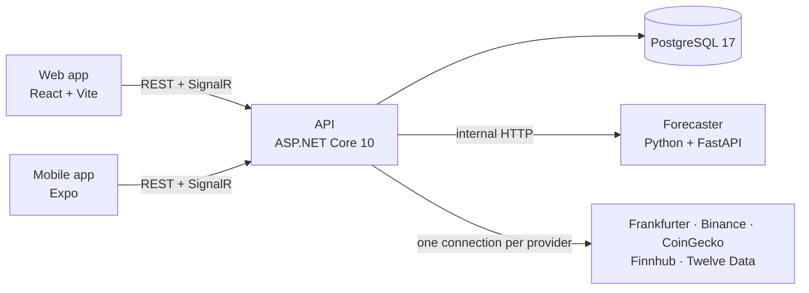

# Marketlens

Marketlens shows live prices for currencies, cryptocurrencies, US stocks and world-index ETFs,
converts between any two of them, and charts their history, on the web and on a phone. Each asset
can show a 1–7 day forecast as a shaded range, together with a measured track record of how often
past forecasts were right. Forecasts are estimates, not financial advice.

> **Status:** in development. The foundation (repository, toolchains, local database and mail
> catcher, CI) is in place; market data, the web app, forecasts, accounts, alerts and the mobile
> app follow in that order. This README is updated as each part lands.

## What v1 will do

- Live prices for ~160 fiat currencies, the top ~30 coins, US stocks and index ETFs, each labelled
  with its source and how fresh it is.
- Convert any amount between any two assets (BTC → TND, EUR → JPY, ETH → BTC).
- Charts from one day to five years, in the display currency you choose.
- Forecast ranges with a plain-language track record, and a clear notice when a forecast is no
  better than "no change".
- Browse everything without an account; sign in (email or Google) to sync watchlists and get
  price alerts as push notifications. Market news next to each asset.
- English, French and German, picked from your device and location, changeable at any time.

## Architecture



- The **API** is the only part that talks to data providers. It keeps one upstream connection per
  provider and fans prices out to every viewer, computes every conversion, and owns accounts,
  watchlists and alerts.
- The **forecaster** is stateless: it receives a price series and returns forecast ranges and a
  backtest. It has no public port.
- The **clients** display and format; they never compute prices or call providers.

More in [docs/architecture.md](docs/architecture.md) and the decision records in
[docs/adr/](docs/adr/).

## Repository layout

```
apps/web/              web app (arrives with the web milestone)
apps/mobile/           mobile app (arrives with the mobile milestone)
packages/shared/       design tokens, UI strings, formatting and API types for both apps
services/api/          ASP.NET Core API and its tests (Marketlens.slnx)
services/forecaster/   Python forecasting service and its tests
docs/                  context, architecture, decision records, feature docs, build records
```

## Running it locally

Requirements: Docker Desktop, Node.js 24+, the .NET 10 SDK, and [uv](https://docs.astral.sh/uv/)
for Python.

```sh
docker compose up -d          # PostgreSQL on :5432, Mailpit on :8025
npm install                   # TypeScript workspaces

cd services/api && dotnet run --project Marketlens.Api          # API on http://localhost:5080
cd services/forecaster && uv run uvicorn forecaster.app:app --port 8001
```

No API keys are needed to run it. Copy `.env.example` to `.env` to add provider keys; every
variable is described there.

## Checks

```sh
npm run lint && npm run typecheck && npm test                    # TypeScript
cd services/api && dotnet format --verify-no-changes && dotnet test
cd services/forecaster && uv run ruff check && uv run mypy && uv run pytest
```

CI runs the same commands plus a gitleaks secret scan on every pull request.

## Data sources

Exchange rates from [Frankfurter](https://frankfurter.dev), crypto prices from Binance public
market data, coin names and logos from [CoinGecko](https://www.coingecko.com), stock prices and
news from [Finnhub](https://finnhub.io), stock history from [Twelve Data](https://twelvedata.com).
Each provider's free tier has its own limits and terms; check them before running a public
instance.

## Contributing and security

See [CONTRIBUTING.md](CONTRIBUTING.md), [CODE_OF_CONDUCT.md](CODE_OF_CONDUCT.md) and
[SECURITY.md](SECURITY.md).

## License

[MIT](LICENSE)
