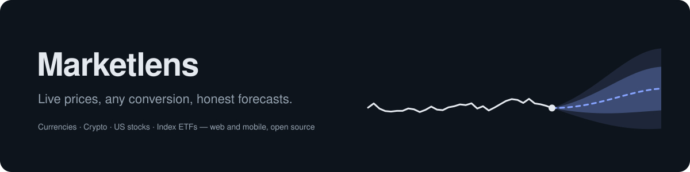
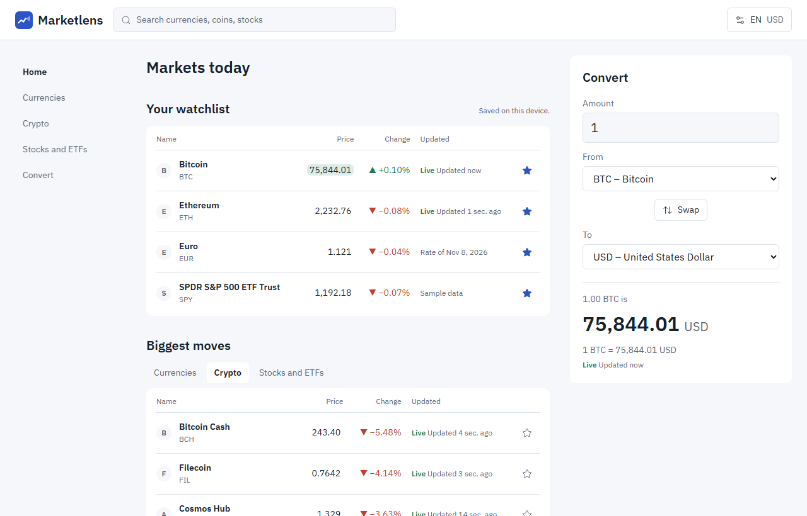
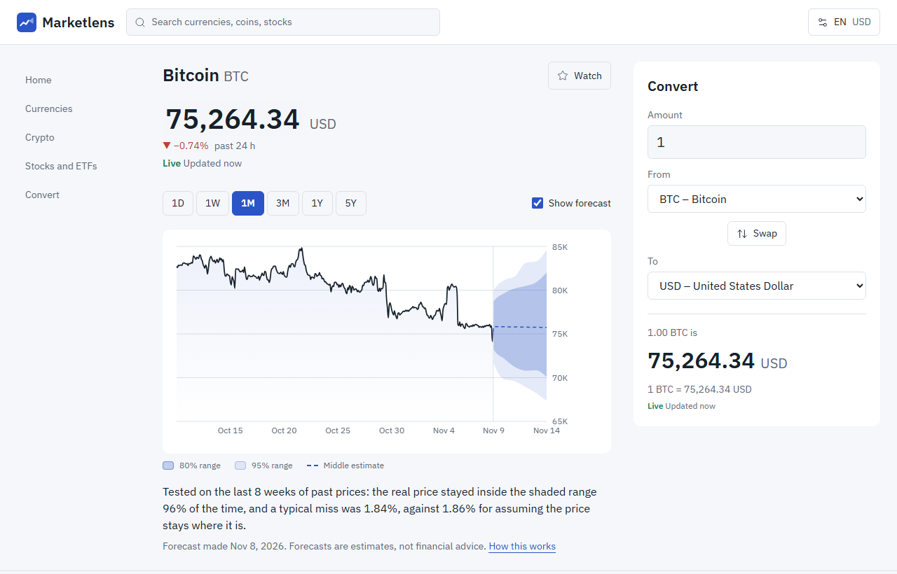
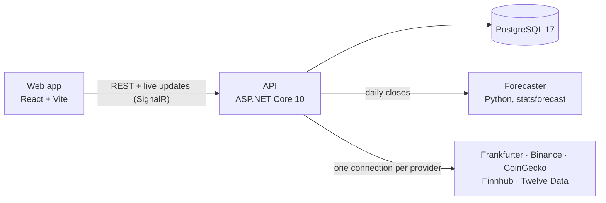

# Marketlens



Marketlens shows live prices for currencies, cryptocurrencies, US stocks and world-index ETFs,
converts between any two of them, and charts their history. Every price says where it comes from
and how current it is. Prices are for information only, not financial advice.

<picture>
  <source media="(prefers-color-scheme: dark)" srcset="docs/images/screenshot-home-dark.png">
  
</picture>

<picture>
  <source media="(prefers-color-scheme: dark)" srcset="docs/images/screenshot-asset-dark.png">
  
</picture>

## What it does

- **Live prices** for 161 currencies, 30 major coins plus Tether, and 50 US stocks and index ETFs.
  Crypto updates every second, in real US dollars; currencies use the daily reference rates central banks publish.
- **Convert** any amount between any two assets: BTC → USD, EUR → JPY, ETH → BTC.
- **Charts** from one day to five years.
- **Forecast ranges** for the next seven days on every chart, with how often past ranges held and
  whether the model beat simply assuming no change. Statistical models, tested every day; estimates,
  not financial advice. [How forecasts work](docs/features/forecasts.md).
- **Your currency everywhere:** every price, chart and conversion is shown in the currency you pick.
- **Watchlist** of the assets you follow, saved in your browser, no account needed.
- **English, French and German**, chosen from your browser and changeable at any time, with light
  and dark themes.
- **Honest freshness:** each price is labelled live, delayed, daily or sample data. Without stock
  API keys, stocks run on clearly marked sample data.

## Architecture



- The **API** is the only part that talks to data providers. It keeps one upstream connection per
  provider, fans prices out to every viewer, and computes every conversion.
- The **forecaster** is an internal Python service: the API sends it an asset's daily closes once a
  day and stores the forecast it returns. It has no database and no public port.
- The **web app** displays and formats; it never computes prices or calls providers.
- In Docker, **nginx** serves the web app and puts the API behind the same address.

More in [docs/architecture.md](docs/architecture.md) and the decision records in
[docs/adr/](docs/adr/).

## Repository layout

```text
apps/web/              web app (React, Vite, Tailwind)
packages/shared/       design tokens, UI strings, formatting and generated API types
services/api/          ASP.NET Core API and its tests (Marketlens.slnx)
services/forecaster/   Python forecasting service (FastAPI, statsforecast) and its tests
docs/                  architecture, decision records, feature walkthroughs, API errors
```

## Running it

### Prerequisites

- [Docker Desktop](https://www.docker.com/products/docker-desktop/)

```sh
docker compose up --build
```

Open http://localhost:8080. The first start takes a few minutes to build; currency and crypto
history fills in within a minute or two after that, and forecast ranges appear over the following
minutes (coins first, about 240 assets in all). No API keys are needed. Copy `.env.example` to
`.env` to add provider keys; every variable is described there.

### Working on the code

#### Prerequisites

- [Docker Desktop](https://www.docker.com/products/docker-desktop/)
- [Node.js](https://nodejs.org/) 24 or later
- [.NET 10 SDK](https://dotnet.microsoft.com/download/dotnet/10.0)
- [uv](https://docs.astral.sh/uv/) for the Python forecaster

```sh
docker compose up -d postgres mailpit   # database and mail catcher only
npm install

cd services/forecaster && uv run uvicorn forecaster.app:app --port 8001   # forecaster
cd services/api && dotnet run --project Marketlens.Api   # API on http://localhost:5080
npm run dev -w @marketlens/web                           # web on http://localhost:5173
```

The web dev server proxies `/api` and `/hubs` to the API, as nginx does in Docker.

Try the API directly:

```sh
curl "localhost:5080/api/v1/conversions?from=crypto:BTC&to=fiat:TND&amount=0.25"
curl "localhost:5080/api/v1/quotes?keys=crypto:BTC,fiat:EUR,stock:AAPL&in=fiat:EUR"
curl "localhost:5080/api/v1/assets/crypto:BTC/history?range=1D"
curl "localhost:5080/api/v1/assets/crypto:BTC/forecast?in=fiat:EUR"
curl "localhost:5080/api/v1/status"
```

The full contract is [services/api/openapi/v1.json](services/api/openapi/v1.json) (also served at
`/openapi/v1.json`); error types are listed in [docs/api/problems.md](docs/api/problems.md), and
each feature has a walkthrough in [docs/features/](docs/features/README.md).

## Checks

```sh
npm run lint && npm run typecheck && npm test                    # TypeScript (web + shared)
cd services/api && dotnet format --verify-no-changes && dotnet test
cd services/forecaster && uv run ruff check && uv run mypy && uv run pytest
```

End-to-end and accessibility checks run against the Docker stack:

```sh
docker compose up -d --build
npx playwright install chromium        # once
npm run test:e2e -w @marketlens/web    # main flows + axe scans of every page, light and dark
```

CI runs the lint, type and unit checks plus a secret scan on every push and pull request.

## Data sources

Exchange rates from [Frankfurter](https://frankfurter.dev), crypto prices from Binance public
market data, coin logos from [CoinGecko](https://www.coingecko.com), stock prices from
[Finnhub](https://finnhub.io), stock history from [Twelve Data](https://twelvedata.com). Each
provider's free tier has its own limits and terms; check them before running a public instance.

## Contributing and security

See [CONTRIBUTING.md](CONTRIBUTING.md) and [SECURITY.md](SECURITY.md).

## License

[MIT](LICENSE)
