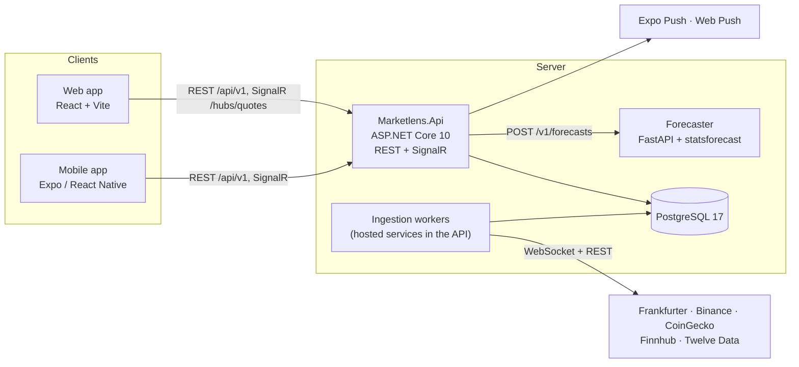

# Marketlens architecture

## Components

## Who decides what

| Layer | Responsibility |
|---|---|
| Clients (web, mobile) | Render, local UI state, format numbers and dates per locale, keep a signed-out watchlist and settings on the device. They send intent and never call providers or compute rates. |
| API (.NET) | The authority: ingestion, quotes, conversions, history, forecast storage, accounts, watchlists, alert rules and evaluation, push delivery, rate limiting. |
| Forecaster (Python) | Stateless maths: forecasts and backtests from a series the API sends. No database, no public port. |
| PostgreSQL | Assets, candles, quote snapshots, forecasts, users, watchlists, alert rules, push subscriptions, notifications, Data Protection keys. |
| Providers | Each behind exactly one adapter in `MarketData/`. Keys come from environment variables. |

## Data flows

- **Live quote:** provider stream → adapter emits a USD `PriceTick` → `QuoteBook` (latest price and
  change, in memory) → `CandleWriter` (1m / 1h / 1d buckets, batched) and `QuoteBroadcaster`
  (SignalR group per asset, at most one message per second per asset) → the client updates the
  price in place.
- **Conversion:** `GET /api/v1/conversions?from=&to=&amount=` → `ConversionCalculator` divides the
  two USD legs; the result is as old as the older leg and as fresh as the slower one. The same
  calculator converts every quote, history point and live tick into the requested display
  currency (`in=`).
- **History:** `GET /api/v1/assets/{key}/history?range=&in=` → `HistoryQuery` picks the candle
  interval for the range and reads a primary-key range from PostgreSQL, down-sampled to at most
  500 points.
- **Forecast:** every 10 minutes `ForecastScheduler` looks for assets with a complete daily close
  newer than their latest forecast (so each asset is forecast once a day, and a fresh database fills
  within minutes), sends the last two years of closes to the forecaster, and stores the answer.
  `ForecastEvaluator` scores past forecast days against the real closes for the live track record.
  `GET /api/v1/assets/{key}/forecast?in=` serves the latest, converted to the display currency.
- **Alert:** every `QuoteBook` update looks up armed rules by asset and by threshold currency in
  memory, compares through `ConversionCalculator`, and on a crossing writes a notification and sends
  a push.

## Why it is shaped this way

- Free provider tiers allow one WebSocket per key and few calls per minute, so one server
  connection per provider fans out to every viewer and keys never reach a client.
- All price maths in one place (`ConversionCalculator`) means the web and mobile apps can't
  disagree.
- Forecasts are honest by construction: ranges, a "no change" baseline every model must beat, and
  a measured track record.

The decisions behind these choices are recorded in [adr/](adr/):

| ADR | Decision |
|---|---|
| [0001](adr/0001-monorepo.md) | One repository with npm workspaces, a .NET solution and a uv project |
| [0002](adr/0002-single-api-with-feature-folders.md) | One API project organised by feature folders |
| [0003](adr/0003-postgres-only.md) | PostgreSQL as the only store in v1 |
| [0004](adr/0004-provider-adapters.md) | One adapter per data provider, USD as the pivot |
| [0005](adr/0005-stateless-forecaster.md) | A stateless Python forecaster called by the API |
| [0006](adr/0006-cookie-auth-for-web-bearer-for-mobile.md) | Cookie sign-in for web, bearer tokens for mobile |
