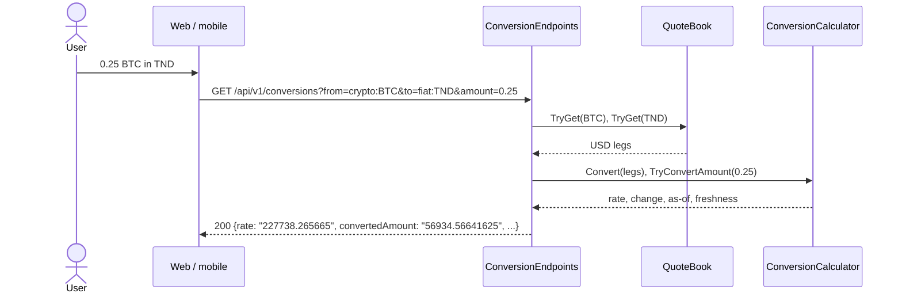

# Currency conversion

> Converts any amount between any two tracked assets (fiat, coins, stocks, ETFs) and expresses
> every price in the user's display currency, with all the arithmetic done once, on the server.

**Status:** shipped on the web (M3); mobile in M7 · **Owner area:**
`services/api/Marketlens.Api/Conversions/` · **Last updated:** 2026-11-08

This is the project's **reference implementation** (D41): new features copy its shape: a thin
endpoint that validates input and answers with typed results, a pure rule class with unit tests,
and generated client types.

## What it does

- `0.25 BTC → TND`, `TND → JPY`, `ETH → BTC`: any pair, because every asset has a USD price and a
  rate is the ratio of the two (D26).
- Shows how current the answer is: a pair is only as current as its **older** leg and as fresh as
  its **slower** leg (a live coin against a daily fiat rate reports `daily`).
- Rates and amounts keep 15 significant digits: providers publish 5–10, and the rest of a ratio of
  two USD prices is rounding residue.
- Amounts must be above 0 and at most 10^15; a result too large to represent is refused clearly.

## Walkthrough

1. The client calls `GET /api/v1/conversions?from=crypto:BTC&to=fiat:TND&amount=0.25`.
2. [ConversionEndpoints.Convert](../../services/api/Marketlens.Api/Conversions/ConversionEndpoints.cs#L41)
   parses both keys (they must be tracked; `fiat:USD` always is), checks the amount, and reads both
   legs from the quote book.
3. [ConversionCalculator.Convert](../../services/api/Marketlens.Api/Conversions/ConversionCalculator.cs#L35)
   divides the USD prices, computes the change from both reference prices, and takes the older
   time and slower freshness.
4. [TryConvertAmount](../../services/api/Marketlens.Api/Conversions/ConversionCalculator.cs#L54)
   multiplies, rounding to 15 significant digits, and reports overflow instead of throwing.
5. The answer carries the rate, both amounts, the change, as-of, freshness and both legs, all
   decimals as strings.

The same calculator converts every quote, chart point and live update into a display currency
(`in=`), through [QuoteReader](../../services/api/Marketlens.Api/Quotes/QuoteReader.cs#L33) and
[HistoryQuery](../../services/api/Marketlens.Api/History/HistoryQuery.cs#L28). Clients never
compute a rate; they only multiply a typed amount by the server's rate for display.

**Alternate flows:** an unknown key → 404 `unknown-asset`; a malformed key or bad amount → 400
`invalid-parameter` naming the parameter; a leg with no price yet → 503 `rate-unavailable` naming
the asset; an amount whose result overflows → 400 on `amount`.

## How it fits together

## Code walkthrough

- **API:** [ConversionEndpoints](../../services/api/Marketlens.Api/Conversions/ConversionEndpoints.cs)
  validates and shapes; returns `Results<Ok<ConversionResponse>, ProblemHttpResult>`, which also
  documents both outcomes in OpenAPI. Problems come from
  [ApiProblems](../../services/api/Marketlens.Api/Http/ApiConventions.cs).
- **Rule:** [ConversionCalculator](../../services/api/Marketlens.Api/Conversions/ConversionCalculator.cs#L24)
  is static and pure (no I/O, no clock). [RoundToSignificantDigits](../../services/api/Marketlens.Api/Conversions/ConversionCalculator.cs#L91)
  derives the decimal places from the value's magnitude, so tiny rates (SHIB in BTC) keep their
  digits.
- **Serialization:** [DecimalAsStringConverter](../../services/api/Marketlens.Api/Http/ApiConventions.cs)
  writes decimals as strings without trailing zeros (D39); the OpenAPI document marks them
  `type: string, format: decimal`, so the generated TypeScript type is `string`.
- **Web:** [ConverterPanel](../../apps/web/src/conversions/ConverterPanel.tsx) on the home, asset and
  convert pages: amount parsed in the visitor's language, asset pickers grouped by class, swap; the
  first answer comes from `/conversions`, then the live hub keeps the rate current and the panel
  multiplies the typed amount by it for display only. The "to" side follows the display currency
  until the visitor picks one.
- **Client types:** `@marketlens/shared/api` ([schema.ts](../../packages/shared/src/api/schema.ts),
  generated, never edited).

## Services and dependencies

| Service | Used for | Where in code | Config / env |
|---|---|---|---|
| Quote book (in memory) | the two USD legs | `QuoteBook` | see [ingestion](market-data-ingestion.md) |

## Data

Reads only; nothing is stored.

## API and contracts

| Method + path | Returns |
|---|---|
| `GET /api/v1/conversions?from=&to=&amount=` | `{from, to, rate, amount, convertedAmount, changePct, asOfUtc, freshness, legs[{key, priceUsd, asOfUtc, source, freshness}]}` |
| `GET /api/v1/conversions/history?from=&to=&range=` | see [price history](price-history-charts.md) |

Public, rate limited per IP (600/min). Errors are listed in [problems.md](../api/problems.md).
Full contract: [openapi/v1.json](../../services/api/openapi/v1.json).

## Configuration

`RateLimits:PublicPerMinute` (600). `ConversionCalculator.SignificantDigits` (15) and
`ConversionEndpoints.MaxAmount` (10^15) are constants, because changing them changes the contract.

## Errors and edge cases

- Same asset both sides → rate exactly 1, change 0.
- A leg without a reference price → `changePct` is null.
- USDT is treated as 1 USD; the data-sources page will say so (M3).

## Testing

[ConversionCalculatorTests](../../services/api/Marketlens.Api.Tests/Conversions/ConversionCalculatorTests.cs)
(fiat↔fiat, crypto↔fiat, crypto↔crypto, slower leg, missing reference, tiny rates, residue,
significant digits, overflow) and [PublicEndpointsTests](../../services/api/Marketlens.Api.Tests/Http/PublicEndpointsTests.cs)
(EUR→TND end to end, invalid parameters, missing leg). By hand:
`curl "localhost:5080/api/v1/conversions?from=crypto:BTC&to=fiat:TND&amount=0.25"`.

## Extending it

A new asset needs nothing here. A new kind of answer (for example fees) belongs in
`ConversionCalculator` with its tests first, then the response record, then
`MARKETLENS_UPDATE_OPENAPI=1 dotnet test` and `npm run generate:api`.

## Known limitations and follow-ups

- The mobile converter arrives in M7.

## Changelog

- 2026-11-08 — Created (marketlens-v1, M2).
- 2026-11-08 — Web converter (M3).
