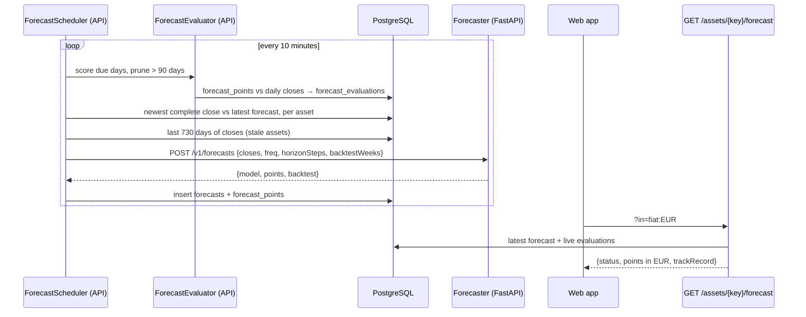

# Forecasts

> Every asset page shows where the price is likely to be over the next seven days, as an 80% and a
> 95% range, with one plain sentence saying how often past ranges held and whether the model did
> better than assuming the price stays where it is.

**Status:** web shipped (M4); mobile in M7 · **Owner area:** `services/forecaster/`,
`services/api/Marketlens.Api/Forecasts/`, `apps/web/src/forecasts/` · **Last updated:** 2026-11-09

## What it does

- **A range, not a predicted price.** The chart's history line hands over, at the last close, to a
  shaded 80% range inside a fainter 95% range, with the middle estimate (the median) dashed. Seven
  calendar days ahead: seven daily steps for crypto, the trading days in that week (five) for
  stocks, ETFs and currencies.
- **A measured track record** under the chart: the share of real closes that fell inside the 80%
  range and the typical miss (mean absolute % error), next to the typical miss of "no change". It
  comes from an eight-week backtest on past prices until Marketlens's own published forecasts for
  the asset have been checked across the whole eight weeks; from then on, from those forecasts.
- **Honest wording** (D57, D59). Three sentences: the forecasts beat "no change"; they did *about
  as well* (the win doesn't show at two decimals); or they did no better. The range is shown in all
  three cases; when no model beat "no change" in the backtest, it is the no-change model's range,
  centred on the last close.
- **Who and where:** anyone, no account. Drawn on the 1W, 1M and 3M charts; on 1D, 1Y and 5Y the
  sentence stays and says where the range is drawn. A "Show forecast" checkbox hides range and
  sentence. Prices follow the display currency (converted at its latest rate, D51).
- **Rules:** an asset needs daily closes reaching back two years (`HistoryDays` = 730); a newer
  asset says so. Forecasts are made once a day per asset, after its daily close.
- The [How forecasts work](../../apps/web/src/pages/ForecastMethodPage.tsx) page (`/how-forecasts-work`)
  explains the method, the record and the limits; it carries the not-financial-advice notice.

## Walkthrough

### Making a forecast (background, API → forecaster)

1. At startup and every 10 minutes, [ForecastScheduler](../../services/api/Marketlens.Api/Forecasts/ForecastScheduler.cs#L20)
   first asks [ForecastEvaluator](../../services/api/Marketlens.Api/Forecasts/ForecastEvaluator.cs#L27)
   to score past forecast days, and to prune forecasts older than 90 days.
2. [FindStaleAsync](../../services/api/Marketlens.Api/Forecasts/ForecastScheduler.cs#L132)
   compares, with two grouped queries, each asset's newest *complete* daily close (today's
   still-open bucket left out; a weekend close counts as Friday's for business-day assets) with
   the `SeriesEndDate` of its latest forecast. Assets with a newer close are due, coins first,
   currencies last.
3. [ForecastAsync](../../services/api/Marketlens.Api/Forecasts/ForecastScheduler.cs#L158) reads the
   last 730 days of daily closes (weekdays only for business-day assets), skips the asset if they
   don't reach back far enough, and posts them through
   [ForecasterClient](../../services/api/Marketlens.Api/Forecasts/ForecasterClient.cs#L81) to the
   forecaster's `POST /v1/forecasts`.
4. The forecaster's [create_forecast](../../services/forecaster/forecaster/app.py#L94) validates the
   series and calls [forecast_closes](../../services/forecaster/forecaster/forecast.py#L71):
   AutoETS, AutoTheta and AutoARIMA are each backtested on log closes by
   [score_model](../../services/forecaster/forecaster/backtest.py#L60) (eight non-overlapping weekly
   windows, refitted at every cut-off), and so is the `Naive` "no change" baseline.
   [choose_model](../../services/forecaster/forecaster/backtest.py#L43) keeps the lowest-error model
   if it is strictly better than the baseline, else the baseline; the chosen model is fitted on all
   closes and forecasts the median and the 80% / 95% ranges, turned back into prices.
5. The client checks the answer against the request
   ([EnsureAnswers](../../services/api/Marketlens.Api/Forecasts/ForecasterClient.cs#L105)): one point
   per step, dated after the last close, positive ranges nested around the median. The scheduler
   stores it with the last input close (`LastCloseUsd`) as a [Forecast](../../services/api/Marketlens.Api/Data/Forecast.cs#L10).

### Showing it (web → API)

1. The asset page ([AssetPage.tsx](../../apps/web/src/pages/AssetPage.tsx#L34)) loads
   `GET /api/v1/assets/{key}/forecast?in=<display currency>` with
   [useForecast](../../apps/web/src/api/queries.ts#L134).
2. [GetForecast](../../services/api/Marketlens.Api/Forecasts/ForecastEndpoints.cs#L70) reads the
   latest forecast; [StatusOf](../../services/api/Marketlens.Api/Forecasts/ForecastEndpoints.cs#L56)
   says `available`, `pending` (enough history, not yet computed) or `insufficient-history`. Points
   are converted into the display currency with `ConversionCalculator.Rate`; the track record is the
   live one when [ReadLiveTrackRecordAsync](../../services/api/Marketlens.Api/Forecasts/ForecastEvaluator.cs#L85)
   finds evaluations spanning the whole window, else the stored backtest. A forecast whose days are
   all past (the forecaster has been down) is not current: the answer is `pending`.
3. [PriceChart](../../apps/web/src/components/PriceChart.tsx#L81) merges history and forecast with
   [toChartPoints](../../apps/web/src/components/PriceChart.tsx#L40) (the last close opens the
   band so there is no gap) and draws the bands on 1W / 1M / 3M only
   ([forecastRanges](../../apps/web/src/components/PriceChart.tsx#L34)).
4. [ForecastNote](../../apps/web/src/forecasts/ForecastNote.tsx#L15) writes the sentence, the date,
   the not-advice notice and the link to the method page.

**Alternate flows:** a new asset shows "No forecast for X yet: forecasts need two years of daily
prices"; a fresh database shows "being prepared" until its first check; a failed load shows
"couldn't be loaded" with **Retry**; turning the checkbox off hides the range and sentence.

## How it fits together



## Code walkthrough

- **Forecaster: maths** ([forecast.py](../../services/forecaster/forecaster/forecast.py),
  [backtest.py](../../services/forecaster/forecaster/backtest.py)). Models work on log prices, so
  ranges stay positive and a % move is the same size at any price; back-transformed, the centre is
  a median. `backtest_window_count` turns weeks into windows of `horizonSteps` (8 weeks → 8 daily
  windows of 7 or 8 business windows of 5). A model that fails to fit or returns non-finite values is
  left out and logged, never silently replaced. Errors and coverage are measured on prices.
- **Forecaster: HTTP** ([app.py](../../services/forecaster/forecaster/app.py)). Pydantic validates at
  the boundary (ascending unique dates, weekdays for `B`, positive closes, 1–30 steps, 1–52 weeks,
  unknown fields refused). The handler is synchronous on purpose: CPU-bound work runs in FastAPI's
  thread pool. Prices go out as plain decimal strings (10 significant digits) because Python writes
  small decimals as `1.2E-7`, which the API's decimal reader refuses.
- **API: client** ([ForecasterClient.cs](../../services/api/Marketlens.Api/Forecasts/ForecasterClient.cs)).
  `ForecastOptions` holds every knob. `ForecastFrequency` serialises as `D` / `B`. A 422 becomes
  `ForecasterRefusedException` with the forecaster's reason.
- **API: scheduling** ([ForecastScheduler.cs](../../services/api/Marketlens.Api/Forecasts/ForecastScheduler.cs)).
  Per-asset failures (a refused series, an HTTP error, a rejected answer, a timeout) are logged, the
  asset is left alone until its next daily close, and the run moves on; not reaching the forecaster
  at all ends the run until the next check, since every asset would fail. History that doesn't reach
  back yet is simply re-checked (one read), because a backfill may still be filling it in.
  `HasEnoughHistoryAsync` is the same history rule for the endpoint, and treats a refused series as
  insufficient history. The typed client recycles pooled connections every 15 minutes, so a
  recreated forecaster container is found at its new address.
- **API: evaluation** ([ForecastEvaluator.cs](../../services/api/Marketlens.Api/Forecasts/ForecastEvaluator.cs)).
  `Evaluate` is the pure scoring rule (inside the 80% range; median error; "no change" error, both
  in % of the actual close). Evaluations are inserted with `ON CONFLICT DO NOTHING`, so runs can
  overlap. The live record needs evaluations from the first week of the window onwards, so "over
  the last 8 weeks of our published forecasts" is never said of a few days; its `beatsBaseline`
  compares the mean errors.
- **API: endpoint** ([ForecastEndpoints.cs](../../services/api/Marketlens.Api/Forecasts/ForecastEndpoints.cs)).
  Copies the `Conversions` shape: parse, validate, typed results, problems from `ApiProblems`.
- **Data** ([Forecast.cs](../../services/api/Marketlens.Api/Data/Forecast.cs)). Points are rows, not
  JSON (D56); the backtest is typed columns.
- **Web** ([PriceChart.tsx](../../apps/web/src/components/PriceChart.tsx),
  [ForecastNote.tsx](../../apps/web/src/forecasts/ForecastNote.tsx),
  [ForecastMethodPage.tsx](../../apps/web/src/pages/ForecastMethodPage.tsx)). The chart is a
  Recharts `ComposedChart`: tuple `dataKey`s draw the range areas. Screen readers get the chart's
  summary sentence, which adds the last forecast day's 80% range. Prices become numbers only for
  drawing; percentages are formatted by `formatPercent` in `packages/shared/src/format.ts`.

## Services and dependencies

| Service | Used for | Where in code | Config / env |
|---|---|---|---|
| Forecaster (FastAPI, `statsforecast` 2.1.1) | backtests and forecasts; stateless, no public port | `services/forecaster/` | `FORECASTER_BASE_URL` (Compose: `http://forecaster:8001`) |
| PostgreSQL | daily closes in, forecasts and evaluations out | `ForecastScheduler`, `ForecastEvaluator`, `ForecastEndpoints` | `DATABASE_URL` |

No external provider is called; forecasts use the candles market data ingestion already stores.

## Data

Migration [AddForecasts](../../services/api/Marketlens.Api/Data/Migrations/20261108224445_AddForecasts.cs):

- `forecasts`: `id`, `asset_id` → `assets` (cascade), `created_at_utc`, `series_end_date`,
  `last_close_usd numeric(38,18)`, `model`, `horizon_days`, `backtest_window_weeks`,
  `backtest_coverage_80_pct`, `backtest_mean_error_pct`, `backtest_baseline_error_pct`
  (`numeric(12,4)`), `backtest_beats_baseline`. Index `(asset_id, created_at_utc desc)`.
- `forecast_points`: PK `(forecast_id, date)`, `median_usd`, `low_80_usd`, `high_80_usd`,
  `low_95_usd`, `high_95_usd` (`numeric(38,18)`), cascade with the forecast.
- `forecast_evaluations`: PK `(forecast_id, target_date)`, `actual_close_usd`,
  `is_inside_range_80`, `error_pct`, `baseline_error_pct`, cascade with the forecast.

Everything is in USD. Forecasts older than 90 days are deleted with their points and evaluations
(about 240 forecasts a day). No personal data.

## API and contracts

**Public:** `GET /api/v1/assets/{key}/forecast?in=<asset key>` (anyone, public rate limit). Contract
in [openapi/v1.json](../../services/api/openapi/v1.json) (`ForecastResponse`).

```json
{
  "status": "available",
  "in": "fiat:USD",
  "model": "AutoTheta",
  "createdAtUtc": "2026-11-08T22:55:05.216843Z",
  "horizonDays": 7,
  "points": [{ "t": "2026-11-08T00:00:00Z", "median": "75848.96512", "low80": "73667.38515",
               "high80": "78171.22371", "low95": "72544.23203", "high95": "78925.18107" }],
  "trackRecord": { "source": "backtest", "windowWeeks": 8, "coverage80Pct": "96.43",
                   "meanErrorPct": "1.84", "baselineErrorPct": "1.86", "beatsBaseline": true }
}
```

`status`: `available` | `pending` | `insufficient-history` (no points, `trackRecord` null for the
last two). Errors: 400 `invalid-parameter` (`key`, `in`), 404 `unknown-asset`, 503
`rate-unavailable` when the display currency has no price yet, 429 — see
[problems.md](../api/problems.md).

**Internal:** forecaster `POST /v1/forecasts`. Request `{assetKey, closes: [{date, close}], freq:
"D"|"B", horizonSteps, backtestWeeks}`; response `{model, points: [{date, median, low80, high80,
low95, high95}], backtest: {windowWeeks, coverage80Pct, meanErrorPct, baselineErrorPct,
beatsBaseline}}`; decimals as strings (D53); 422 for a malformed or too-short series. Recorded
fixtures: [services/forecaster/tests/contract/](../../services/forecaster/tests/contract/), read by
both services' tests.

## Configuration

`Forecasts` section in [appsettings.json](../../services/api/Marketlens.Api/appsettings.json), read
into `ForecastOptions`:

| Key | Default | Effect |
|---|---|---|
| `HorizonDays` | 7 | Calendar days ahead |
| `BacktestWeeks` | 8 | Backtest windows, and the window the live track record must span |
| `HistoryDays` | 730 | Closes sent; an asset with less history has no forecast |
| `CheckInterval` | 00:10:00 | How often the scheduler looks for new closes |
| `RequestTimeout` | 00:02:00 | One asset's forecaster call |
| `RetentionDays` | 90 | Forecasts deleted after this |

`FORECASTER_BASE_URL` (env, [.env.example](../../.env.example)) overrides `Forecasts:BaseUrl`.
Web: [forecastRanges](../../apps/web/src/components/PriceChart.tsx#L34).

## Errors and edge cases

- **Forecaster down:** the check logs one warning and retries in 10 minutes; pages keep the last
  forecast with its date while any of its days is today or later, then say `pending`. In Compose
  the API waits for the forecaster's health check before starting.
- **Too-short or malformed series:** 422 from the forecaster, logged with the reason; the asset waits
  for its next close and the page says it needs two years of history.
- **Forecaster error on one series (500), bad answer** (wrong count, stale dates, inverted ranges)
  **or a slow asset** (2-minute timeout): logged, nothing stored, the asset waits for its next close,
  the run continues; its page says `pending`.
- **A model can't fit** (flat pegs): left out of the choice; a flat peg ends as "no change".
- **Overlapping evaluation runs:** `ON CONFLICT DO NOTHING`.
- **Display currency without a price:** 503 `rate-unavailable`.
- **Pivot:** `fiat:USD` has daily closes at exactly 1, so its forecast is "no change" and says so.

## Testing

- Forecaster: `cd services/forecaster && uv run pytest` — [test_backtest.py](../../services/forecaster/tests/test_backtest.py)
  (baseline rule, windows, steady trend beats no change, flat peg doesn't, too short refused),
  [test_forecast_api.py](../../services/forecaster/tests/test_forecast_api.py) (recorded contract
  shape, dates, nesting, 7 malformed requests, 422 with the count needed).
- API: `cd services/api && dotnet test` — [ForecasterContractTests](../../services/api/Marketlens.Api.Tests/Forecasts/ForecasterContractTests.cs)
  (same fixtures, both directions, rejected answers),
  [ForecastSchedulerTests](../../services/api/Marketlens.Api.Tests/Forecasts/ForecastSchedulerTests.cs)
  (frequency and steps, status, current forecast, scoring, end to end through
  [ForecasterStub](../../services/api/Marketlens.Api.Tests/ForecasterStub.cs): business-day points,
  EUR conversion, "not better" asset, insufficient history, problems, a 500 on one ETF doesn't stop
  the others, 21 recent days keep the backtest record, days spanning the window make it live).
- Web: `npm test` ([PriceChart.test.ts](../../apps/web/src/components/PriceChart.test.ts)); E2E
  `npm run test:e2e -w @marketlens/web` (forecast flow, axe on the method page).
- **By hand:** `docker compose up --build`, wait a few minutes, open
  <http://localhost:8080/assets/crypto:BTC>: the band on 1M, the sentence, the tooltip over the band;
  switch to 1Y (hint), untick "Show forecast", follow "How this works"; open `/assets/fiat:XCG`
  (insufficient history); switch the display currency to EUR (band in euros).

## Extending it

- **Another model:** add it to `CANDIDATE_MODELS` in [forecast.py](../../services/forecaster/forecaster/forecast.py#L23);
  it competes in the backtest automatically. Check the time per asset (AutoARIMA ≈ 1–2 s).
- **Another horizon or window:** change `HorizonDays` / `BacktestWeeks`; the request carries both,
  the forecaster derives its windows.
- **Machine-learning models later:** keep the contract; only the forecaster changes (ADR 0005).
- **Mobile (M7):** reuse the endpoint, `formatPercent` and the `forecast.*` strings; the chart needs
  the same hand-over logic as `toChartPoints`.

## Known limitations and follow-ups

- Models see only past prices: no news, earnings or shocks. Eight weeks is a small sample; most
  coins beat "no change" by chance-sized margins (why D57 always shows the range and words it
  honestly).
- Display currencies use today's rate for every forecast day (FX uncertainty not included).
- Failed series are remembered in memory: after an API restart each is tried once more.
- Each forecast day is scored once per forecast that covers it (up to seven), so live figures weight
  days by how many forecasts reached them, as the backtest does.
- After adding a Finnhub key, sample-data stock forecasts stay until the next complete close.
- Sample stocks get forecasts too (labelled sample data on the page).

## Changelog

- 2026-11-09 — Created (marketlens-v1, M4: forecaster, scheduler, evaluator, endpoint, web range,
  method page; D51–D59).
- 2026-11-09 — Code review fixes (D60): one asset's failure no longer stops the run and waits for
  its next close; the live record needs the whole window; outdated forecasts read `pending`;
  `MinLiveEvaluations` removed; the "no better" sentence no longer says where the range is centred.
