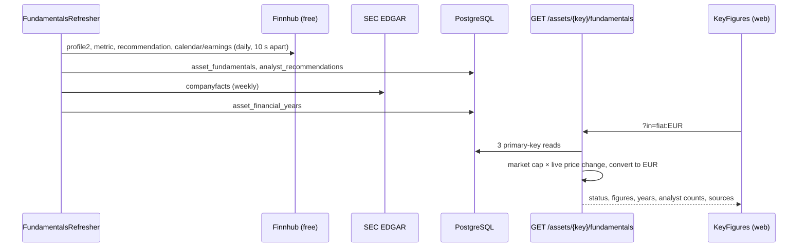

# Key figures

> Stock pages show a company's market cap, ratios and dates, five years of revenue and net income
> from its SEC filings, and what analysts reported, each with its source.

**Status:** shipped on the web; mobile in M7 · **Owner area:**
`services/api/Marketlens.Api/Fundamentals/`, `apps/web/src/fundamentals/` · **Last updated:** 2026-11-16

## What it does

- On every **stock** page, a "Key figures" section under the chart lists the market cap, shares
  outstanding, price / earnings and earnings per share (last twelve months), dividend yield, the
  52-week range, beta, the next earnings report date, industry, exchange, listing date and website.
- A bar chart shows **revenue and net income** for the last five fiscal years, from the company's
  10-K filings at the SEC. A loss draws below zero.
- A table shows **what analysts reported** to Finnhub over the last four months (strong buy … strong
  sell counts), named as other people's opinions, never Marketlens advice.
- Money is shown in the display currency at today's exchange rate. The market cap moves with the
  stock's live price; everything else is as of the last refresh (daily for Finnhub, weekly for SEC).
- Company logos from Finnhub appear next to stocks in lists.
- ETFs, coins and currencies have no section: no free source covers them.
- Without a Finnhub key, the section says key figures need one; nothing is made up (sample prices
  are a random walk, so a sample market cap would mislead).

## Walkthrough

1. At startup and then every hour,
   [FundamentalsRefresher](../../services/api/Marketlens.Api/Fundamentals/FundamentalsRefresher.cs#L105)
   looks for stocks whose Finnhub figures are a day old or whose SEC figures are a week old.
2. For a stock due at Finnhub, [RefreshFromFinnhubAsync](../../services/api/Marketlens.Api/Fundamentals/FundamentalsRefresher.cs#L168)
   reads the profile, basic financials, analyst counts and earnings calendar through
   [FinnhubClient](../../services/api/Marketlens.Api/MarketData/FinnhubClient.cs#L84), 10 seconds
   apart, and writes `asset_fundamentals` and `analyst_recommendations` in one transaction.
3. For a stock due at the SEC, [RefreshFromSecAsync](../../services/api/Marketlens.Api/Fundamentals/FundamentalsRefresher.cs#L222)
   reads its company facts through [SecEdgarClient](../../services/api/Marketlens.Api/MarketData/SecEdgarClient.cs#L61)
   and replaces its rows in `asset_financial_years`.
4. Right after a stock's Finnhub refresh, a new logo goes to `assets.logo_url` through
   `AssetCatalog.UpdateLogosAsync`.
5. The asset page renders [KeyFigures](../../apps/web/src/fundamentals/KeyFigures.tsx#L36) for a
   stock; it calls `GET /api/v1/assets/{key}/fundamentals?in=<display currency>`.
6. [GetFundamentals](../../services/api/Marketlens.Api/Fundamentals/FundamentalsEndpoints.cs#L92)
   reads the three tables by primary key, moves the market cap with the live price, converts money
   into the display currency and answers with a status.

**Alternate flows:** a stock not fetched yet → `pending` ("being collected"); no Finnhub key →
`no-provider-key`; an ETF or coin → `not-covered` (the web doesn't ask); a failed load → retry.

## How it fits together



## Code walkthrough

- **Adapters** (one per provider, in `MarketData/`):
  - [FinnhubClient](../../services/api/Marketlens.Api/MarketData/FinnhubClient.cs) — the quote
    adapter gained the free fundamentals. Static parsers ([ParseCompanyProfile](../../services/api/Marketlens.Api/MarketData/FinnhubClient.cs#L112),
    [ParseBasicFinancials](../../services/api/Marketlens.Api/MarketData/FinnhubClient.cs#L135), …)
    treat provider data as untrusted: only absolute `https` websites, logos only from
    `static.finnhub.io` / `static2.finnhub.io`, text cut at 120 characters, numbers read from the
    JSON text. Finnhub sends market cap and shares in millions; they are stored in units. Money of a
    company reporting in another currency is left out.
  - [SecEdgarClient](../../services/api/Marketlens.Api/MarketData/SecEdgarClient.cs#L80) — reads
    annual figures from a company's XBRL facts. Only 10-K facts lasting 350–380 days count; a
    period repeated in later filings keeps the latest filed. Companies use different revenue tags and
    change them (Apple moved tags in 2018, banks use `Revenues`), so per company the **primary tag**
    is the first in the fallback order that reports the newest year; it supplies every year it has
    and other tags only fill gaps. Mixing tags year by year mixed Mastercard's gross and net revenue.
- **Refresher** ([FundamentalsRefresher](../../services/api/Marketlens.Api/Fundamentals/FundamentalsRefresher.cs#L79)):
  one stock's failure is logged with `ProviderBackoff` and the run moves on; the stored figures keep
  being served with their age. [ConsistentShares](../../services/api/Marketlens.Api/Fundamentals/FundamentalsRefresher.cs#L68)
  drops Finnhub's share count when shares × price is more than 5% away from its own market cap
  (Berkshire's came back as 1.43 million, another share class).
- **Endpoint** ([FundamentalsEndpoints](../../services/api/Marketlens.Api/Fundamentals/FundamentalsEndpoints.cs)):
  [StatusOf](../../services/api/Marketlens.Api/Fundamentals/FundamentalsEndpoints.cs#L75) (stored
  figures are served even if the key was removed later),
  [CurrentMarketCapUsd](../../services/api/Marketlens.Api/Fundamentals/FundamentalsEndpoints.cs#L84)
  (stored cap × current price ÷ price at fetch). Money goes through
  `ConversionCalculator.ConvertSignedAmount`, which accepts losses (`Rate` only takes positive prices).
- **Web** ([KeyFigures.tsx](../../apps/web/src/fundamentals/KeyFigures.tsx)): owns its query
  (`useFundamentals`, stale after an hour), formats the API's figures (`formatCompact`: 94.66B,
  478,8 Mrd.), draws the bars ([FinancialYears](../../apps/web/src/fundamentals/KeyFigures.tsx#L195))
  with a spoken summary and a visually hidden table, and the analyst table
  ([AnalystTrends](../../apps/web/src/fundamentals/KeyFigures.tsx#L342)) with its source and the
  not-advice line. Loading, error, pending and no-key states are handled in place.

## Services and dependencies

| Service | Used for | Where in code | Config / env |
|---|---|---|---|
| Finnhub (free) | profile, basic financials, analyst counts, earnings calendar, logos; key in a header | `FinnhubClient` | `FINNHUB_API_KEY` |
| SEC EDGAR (public) | annual revenue and net income; no key, ≤ 10 requests/s, a contact in the User-Agent | `SecEdgarClient` | `SEC_USER_AGENT` |
| PostgreSQL | the three tables | `Data/AssetFundamentals.cs` | `DATABASE_URL` |

Finnhub calls share the free 60 a minute with quote polling (25 a minute); 38 stocks × 4 calls a day
at 10 s spacing stays near 6 a minute. Finnhub's free data is for personal use and may not be
redistributed ([provider terms](../provider-terms.md)); SEC data is public, cited on the page.

## Data

Migration `20261116163620_AddFundamentals` (three new tables, cascade-deleted with the asset):

- `asset_fundamentals` — one row per stock: profile text, `market_cap_usd` and `shares_outstanding`
  (`numeric(24,4)`, since company totals at scale 18 would overflow .NET's decimal),
  `market_cap_price_usd`, ratios and per-share values (`numeric(38,18)`), `next_earnings_date`,
  `finnhub_fetched_at_utc`, `sec_fetched_at_utc`.
- `asset_financial_years` — key (asset, period end): period start, `revenue_usd`, `net_income_usd`
  (may be negative), filed date. Replaced on every SEC refresh.
- `analyst_recommendations` — key (asset, month): five counts. Replaced on every Finnhub refresh.

No personal data. Each stock's SEC id is curated in `MarketData/assets.json` (`secCik`).

## API and contracts

`GET /api/v1/assets/{key}/fundamentals?in=fiat:EUR` — public, rate-limited like every `/api/v1` route.

```json
{
  "status": "available | pending | no-provider-key | not-covered",
  "in": "fiat:EUR",
  "asOfUtc": "2026-11-16T16:49:34Z",
  "profile": { "industry": "Technology", "country": "US", "exchange": "NASDAQ NMS - GLOBAL MARKET",
               "ipoDateUtc": "1986-08-20T00:00:00Z", "websiteUrl": "https://www.adobe.com/" },
  "figures": { "marketCap": "85655905577.58", "sharesOutstanding": "389200000", "peRatio": "12.9883",
               "epsTtm": "16.2164", "dividendYieldPct": null, "high52Week": "328.22",
               "low52Week": "172.04", "beta": "1.4583", "nextEarningsDateUtc": "2026-12-09T00:00:00Z" },
  "financialYears": [ { "periodEndUtc": "2025-11-28T00:00:00Z", "revenue": "21509043480", "netIncome": "6452079600" } ],
  "analystTrends": [ { "periodUtc": "2026-11-01T00:00:00Z", "strongBuy": 7, "buy": 8, "hold": 24, "sell": 6, "strongSell": 0 } ],
  "sources": ["finnhub", "sec-edgar"]
}
```

Decimals are strings; every figure may be null; years and months newest first. Errors: 400
`invalid-parameter` (key), 404 `unknown-asset` (asset or display currency), 503 `rate-unavailable`.
The OpenAPI document is `services/api/openapi/v1.json` (tag `Fundamentals`).

## Configuration

| Key | Default | Where |
|---|---|---|
| `FINNHUB_API_KEY` | empty (no figures) | env, `.env.example` |
| `SEC_USER_AGENT` | empty (no annual figures) | env, `.env.example`: `Marketlens you@example.com` |
| `Fundamentals:RefreshInterval` | `1.00:00:00` | `appsettings.json` |
| `Fundamentals:SecRefreshInterval` | `7.00:00:00` | `appsettings.json` |
| `Fundamentals:RequestSpacing` | `00:00:10` | `appsettings.json` |
| `Fundamentals:CheckInterval` | `01:00:00` | `appsettings.json` |
| `Fundamentals:FinancialYears` / `RecommendationMonths` / `EarningsLookaheadDays` | 5 / 4 / 120 | `appsettings.json` |
| `Fundamentals:SharesTolerancePct` | 5 | `appsettings.json` |
| `MarketData:SecEdgar:RequestTimeout` | `00:01:00` (option default) | `SecEdgarOptions` |
| `secCik` per stock | curated | `MarketData/assets.json` (10 digits, checked at startup) |

## Errors and edge cases

- Finnhub or SEC down, throttled (429 / 403) or answering something unexpected: the stock is logged
  and skipped with a growing backoff; its stored figures stay, with their date on the page.
- A truncated SEC download (seen once while recording) fails that stock's refresh the same way.
- A figure Finnhub doesn't report (no dividend, a P/E during a loss) shows "Not reported".
- Without `SEC_USER_AGENT`, the chart says there are no annual figures yet and the footer credits
  Finnhub only (it follows the response's `sources`).
- A company reporting in another currency: money figures are left out rather than mislabelled.
- A stock without a quote yet: the market cap is Finnhub's as fetched.
- Restated filings: the latest filed value wins; stored years are replaced, not merged.

## Testing

- [SecEdgarClientTests](../../services/api/Marketlens.Api.Tests/MarketData/SecEdgarClientTests.cs):
  Apple's five years and its pre-2018 tag, quarterly facts left out, a bank (JPM), a loss (INTC),
  Mastercard's primary tag and net-income fallback — against filings recorded on 2026-11-16.
- [FinnhubAndCoinGeckoTests](../../services/api/Marketlens.Api.Tests/MarketData/FinnhubAndCoinGeckoTests.cs):
  parsers against recorded answers, plus the safety rules (http / javascript websites, foreign logo
  hosts, long text, non-USD money).
- [FundamentalsTests](../../services/api/Marketlens.Api.Tests/Fundamentals/FundamentalsTests.cs):
  the refresher over fixtures with a test key, then the endpoint (figures, years, analyst months,
  sources, a loss in USD and EUR, statuses, problem details, exact totals through the database).
- Web: `formatCompact` in `packages/shared/src/format.test.ts`; E2E "shows a stock's key figures, or
  says why they are missing" and axe on `/assets/stock:ADBE` in `apps/web/e2e/app.spec.ts`.
- By hand: set `FINNHUB_API_KEY` and `SEC_USER_AGENT` in `.env`, `docker compose up -d --build`,
  wait a few minutes, open a stock page; `curl "localhost:8080/api/v1/assets/stock:ADBE/fundamentals?in=fiat:EUR"`.

## Extending it

- **A new figure from Finnhub:** a property on `BasicFinancials` (or `CompanyProfile`) and its
  parser line, a nullable column + migration, one line in the refresher and the endpoint record,
  regenerate the contract and types, one row and string in `KeyFigures`.
- **A new stock:** its `assets.json` entry with `secCik` (from `https://www.sec.gov/files/company_tickers.json`;
  check it has filings).
- **ETFs or coins:** a source for them makes `not-covered` an `available` status for that class; the
  endpoint shape and the web section don't change.

## Known limitations and follow-ups

- No company descriptions (premium at Finnhub), no ETF data, no quarterly figures.
- Foreign filers (20-F, IFRS) aren't in the universe; their facts aren't under `us-gaap` and would
  show no annual figures.
- Finnhub's free terms limit public display; the public demo stays gated (CONTEXT, open questions).

## Changelog

- 2026-11-16 — Created (roadmap-and-fundamentals, PR C). Logos are stored per stock right after its
  refresh (first version stored them at the end of a run, so a restart lost them for a day).
