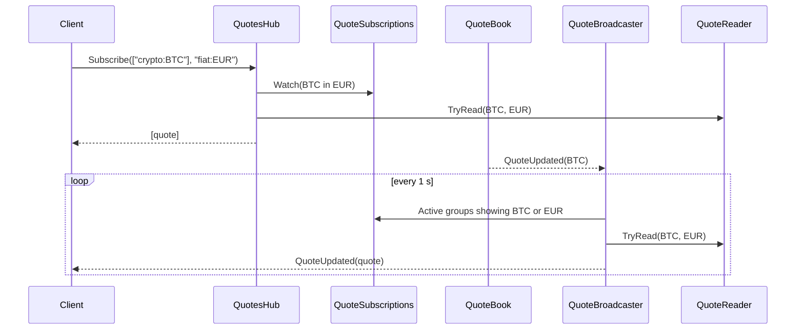

# Live quotes

> Serves the latest price of any asset in any display currency over REST, and pushes new prices to
> watching clients within about a second over SignalR, without a page refresh.

**Status:** shipped on the web (M3); mobile in M7 · **Owner area:**
`services/api/Marketlens.Api/Quotes/` · **Last updated:** 2026-11-09

## What it does

- Lists and searches the tracked assets, and returns quotes for up to 50 of them at once, each in
  the display currency the client asks for (`in=`, default `fiat:USD`).
- A quote carries the price, change and its basis (`previous-close` for stocks, ETFs, fiat and
  Tether; `rolling-24h` for other crypto, D40), time, source and freshness. Crypto prices are in
  real USD (ADR 0007).
- Live: a client subscribes to the assets on screen and receives at most one update per asset per
  second, already converted. A move in the display currency itself (a new euro rate) refreshes
  every quote shown in it.
- Limits: 50 assets per connection, 5 connections per client IP, 10 subscribe calls per 10 s.

## Walkthrough

1. The client lists assets with `GET /api/v1/assets?class=crypto&limit=50`
   ([ListAssets](../../services/api/Marketlens.Api/Quotes/QuoteEndpoints.cs#L38)) and pages with
   `nextCursor` (the last key of the page).
2. It loads prices with `GET /api/v1/quotes?keys=crypto:BTC,fiat:EUR&in=fiat:TND`
   ([GetQuotes](../../services/api/Marketlens.Api/Quotes/QuoteEndpoints.cs#L103)); assets without a
   price yet are left out.
3. It connects to `/hubs/quotes` and calls `Subscribe(["crypto:BTC","fiat:EUR"], "fiat:TND")`
   ([QuotesHub.Subscribe](../../services/api/Marketlens.Api/Quotes/QuotesHub.cs#L111)), which
   answers with the current quotes and joins one group per asset and display currency.
4. When a price moves, [QuoteBroadcaster](../../services/api/Marketlens.Api/Quotes/QuoteBroadcaster.cs#L22)
   (subscribed to `QuoteBook.QuoteUpdated`) marks it; every second
   [BroadcastMovedAsync](../../services/api/Marketlens.Api/Quotes/QuoteBroadcaster.cs#L66) sends
   `QuoteUpdated(quote)` to each affected group.
5. The client updates the price in place. `Unsubscribe(keys)` stops it; disconnecting cleans up.

**Alternate flows:** invalid or unknown keys → `HubException` with the reason (REST: problem
details); too many assets, connections or subscribe calls → refused; no price yet → the asset is
missing from the answer until its first price arrives.

## How it fits together

## Code walkthrough

- **Shaping a quote:** [QuoteReader](../../services/api/Marketlens.Api/Quotes/QuoteReader.cs#L33)
  is the one place that turns two USD quotes into a `QuoteResponse` (through
  `ConversionCalculator`), used by REST and the hub, so they can't disagree.
- **REST:** [QuoteEndpoints](../../services/api/Marketlens.Api/Quotes/QuoteEndpoints.cs) reads the
  in-memory catalogue and quote book only; no database query per request.
  `TryParseDisplayCurrency` is shared with history.
- **Hub state:** [QuoteSubscriptions](../../services/api/Marketlens.Api/Quotes/QuotesHub.cs)
  counts watchers per group and connections per client IP. `Subscribe` validates every key and the
  cap **before** changing anything, so a refused request can't leave the connection's set and the
  shared counts out of step (which once let one client silence another's prices; see the M2.11
  log).
- **Broadcasting:** groups are `quotes:<asset>:<in>`; the broadcaster sends only to groups whose
  asset or display currency moved.

## Web layer (M3)

- [liveQuotes.ts](../../apps/web/src/api/liveQuotes.ts): one SignalR connection for the app,
  watcher counting so components share subscriptions, resubscribe after reconnecting, and a quote
  store read with `useSyncExternalStore`; REST answers ([queries.ts](../../apps/web/src/api/queries.ts))
  seed the same store.
- [QuoteParts.tsx](../../apps/web/src/components/QuoteParts.tsx): `Price` flashes its up/down colour
  for 600 ms (skipped under reduced motion), `Change` pairs ▲/▼ and spoken text with colour,
  `Freshness` writes "Live, updated 2 sec. ago", "Rate of Nov 8, 2026" (fiat, and Tether, whose own
  source is Frankfurter's daily rates), "Live, with the EUR rate of Nov 8, 2026" or "Sample data".
- [AssetTable.tsx](../../apps/web/src/components/AssetTable.tsx): rows read their own quote, so a
  price update re-renders one row. Through Docker, nginx upgrades `/hubs/` to a WebSocket.

## Services and dependencies

| Service | Used for | Where in code | Config / env |
|---|---|---|---|
| ASP.NET Core SignalR | WebSocket / long-polling transport | `QuotesHub`, `Program.cs` | — |
| Quote book, catalogue | prices and asset list | `MarketData/` | see [ingestion](market-data-ingestion.md) |

## Data

Reads only (in memory).

## API and contracts

| Method + path | Returns |
|---|---|
| `GET /api/v1/assets?class=&search=&cursor=&limit=` | `{items: Asset[], nextCursor}` |
| `GET /api/v1/assets/{key}?in=` | `{asset: Asset, quote: Quote \| null}` |
| `GET /api/v1/quotes?keys=a,b&in=` (≤50) | `Quote[]` |
| `GET /api/v1/status` | `{checkedAtUtc, stockData, sources[{source, quoteCount, newestAsOfUtc, oldestAsOfUtc, freshness}]}` |
| SignalR `/hubs/quotes`: `Subscribe(keys[], in)` → `Quote[]`; `Unsubscribe(keys[])`; server → `QuoteUpdated(Quote)` | |

`Asset {key, class, symbol, name, logoUrl, tracks}`; `Quote {key, price, in, changePct,
changeBasis, asOfUtc, source, freshness}`. Prices are decimal strings. Contract:
[openapi/v1.json](../../services/api/openapi/v1.json); errors: [problems.md](../api/problems.md).
SignalR uses the same JSON conventions as REST.

## Configuration

| Key | Default | Where |
|---|---|---|
| `Quotes:BroadcastIntervalMs` | 1000 | `appsettings.json` |
| `RateLimits:PublicPerMinute` | 600 | `appsettings.json` |
| Hub limits (50 keys, 5 connections, 10 subscribes / 10 s) | constants | `QuotesHub` |

## Errors and edge cases

- A crypto price shown in EUR reports `daily` freshness (the slower leg). The UI should say
  "live · EUR rate of <date>" (M3), not treat it as stale.
- The connection limit uses the client IP after forwarded headers, which are trusted only from the
  configured proxy network (or loopback).

## Testing

[QuotesHubTests](../../services/api/Marketlens.Api.Tests/Quotes/QuotesHubTests.cs) (real SignalR
client: subscribe answer, pushed update converted, 51 keys, unknown key, refused subscribe can't
unwatch another client, 6th connection) and
[PublicEndpointsTests](../../services/api/Marketlens.Api.Tests/Http/PublicEndpointsTests.cs)
(paging, search, quotes in EUR, asset detail, rate limit). By hand:
`curl "localhost:5080/api/v1/quotes?keys=crypto:BTC,fiat:EUR&in=fiat:TND"`.

## Extending it

A new field on a quote: add it to `QuoteResponse`, fill it in `QuoteReader.FromUsd`, regenerate the
contract (`MARKETLENS_UPDATE_OPENAPI=1 dotnet test`) and the types (`npm run generate:api`).

## Known limitations and follow-ups

- Single instance; several API instances need a SignalR backplane (ADR 0003).
- Unchanged prices are re-sent each second for assets whose provider re-reports them.

## Changelog

- 2026-11-08 — Created (marketlens-v1, M2).
- 2026-11-08 — Web screens and live store; public rate limit raised from 120 to 600 per minute per IP (M3).
- 2026-11-09 — Tether: previous-close basis and "Rate of" label; crypto in real USD (price-and-forecast-accuracy).
