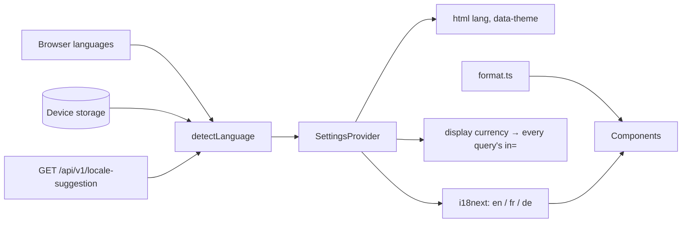

# Localization

> Shows Marketlens in English, French or German and every price in the visitor's display currency,
> chosen automatically on the first visit and changeable at any time.

**Status:** shipped on the web (M3); mobile in M7 · **Owner area:** `packages/shared/src/i18n/`,
`apps/web/src/settings/`, `services/api/Marketlens.Api/Locale/` · **Last updated:** 2026-11-08

## What it does

- **Language:** the visitor's saved choice wins; otherwise the first supported language in the
  browser's languages; otherwise the API's suggestion; otherwise English (D22).
- **Display currency:** the saved choice, otherwise the currency of the first known region in the
  browser's languages (`fr-TN` → TND, `de-CH` → CHF), otherwise US dollars. Every price, chart and
  converter default follows it (D36).
- **Formatting** follows the language: `87,412.55` / `87 412,55` / `87.412,55`; signed changes with a
  true minus sign; dates and "2 sec. ago" in the language's words. Typed amounts accept the
  language's decimal separator (`0,25` in French).
- **Theme:** device setting, light or dark.
- Choices are saved on the device and shared by every open tab. IP-country lookup (GeoLite2) is not
  in yet (D47).

## Walkthrough

1. On first load, [SettingsProvider](../../apps/web/src/settings/Settings.tsx) finds no saved
   language or currency and asks `GET /api/v1/locale-suggestion`; the browser sends its
   `Accept-Language` automatically.
2. [LocaleSuggester.Suggest](../../services/api/Marketlens.Api/Locale/LocaleSuggester.cs) picks the
   first supported language by quality value and the first known region's currency.
3. [detectLanguage](../../packages/shared/src/detectLanguage.ts) combines the saved choice, the
   device languages and the suggestion; the provider sets `<html lang>`, switches i18next and
   applies `data-theme`.
4. The visitor opens **Settings** in the header ([SettingsMenu](../../apps/web/src/app/SettingsMenu.tsx))
   and picks a language, a display currency or a theme; the choice is written to device storage
   ([deviceStorage](../../apps/web/src/settings/deviceStorage.ts)) and every component updates.
5. Components format through [format.ts](../../packages/shared/src/format.ts) and read strings with
   `t("…")` from [en.json](../../packages/shared/src/i18n/en.json), `fr.json`, `de.json`.

**Alternate flows:** the suggestion call fails → device languages and US dollars; device storage is
blocked (private mode) → choices last for the session only; an asset shown in itself (EUR in EUR)
→ its page uses US dollars instead.

## How it fits together

## Code walkthrough

- **Shared strings:** one JSON file per language in `packages/shared/src/i18n/`, used by web now and
  mobile later. [messages.test.ts](../../packages/shared/src/i18n/messages.test.ts) fails if French
  or German lacks a key or a placeholder English has.
- **Typed keys:** [i18n.ts](../../apps/web/src/i18n.ts) declares the English file as the resource
  type, so a misspelt key fails `tsc`.
- **Formatting:** `formatPrice` picks precision by size (≥ 10: two decimals; 1–10: up to four, which
  exchange rates need; < 1: four significant digits); `parseAmount` reads the language's group and
  decimal separators and returns an exact decimal string for the API.
- **Theme:** `tokens.css` (generated from `tokens.ts`) defines both palettes; `data-theme` overrides
  the device preference.

## Services and dependencies

| Service | Used for | Where in code | Config / env |
|---|---|---|---|
| API locale suggestion | first-visit language and currency | `Locale/LocaleSuggester.cs` | — (`MAXMIND_LICENSE_KEY` later, D47) |
| i18next / react-i18next | strings and language switching | `apps/web/src/i18n.ts` | — |
| `Intl` (browser) | numbers, percentages, dates, relative times | `packages/shared/src/format.ts` | — |

## Data

Device storage keys: `marketlens.language`, `marketlens.displayCurrency`, `marketlens.theme`.
Nothing personal; nothing on the server until accounts arrive (M5 syncs settings).

## API and contracts

`GET /api/v1/locale-suggestion` → `{language: "en"|"fr"|"de", displayCurrency: "fiat:XXX", reason:
"browser-language"|"default"}`.

## Configuration

None. Supported languages are `supportedLanguages` in `format.ts`; the country → currency table is
`CurrencyByCountry` in `LocaleSuggester.cs`.

## Errors and edge cases

- A browser language Marketlens doesn't speak (Arabic, Japanese) → the next supported one, else
  English; the currency can still come from the region (`ar-TN` → TND).
- Right-to-left layout is not in v1; layouts use logical properties (`ps-`, `ms-`, `start-`) to make
  it easier later.

## Testing

`packages/shared/src/format.test.ts` (formats per language, amount parsing, language order),
`messages.test.ts`, API `HistoryStatusLocaleTests` (7 Accept-Language cases), E2E
`apps/web/e2e/app.spec.ts` (German browser → German UI; switching to English; French decimal
comma). By hand: change the browser language, or use Settings in the header.

## Extending it

**A new language:** add `packages/shared/src/i18n/<code>.json` with every key, add the code to
`supportedLanguages` and `languageNames` ([SettingsMenu](../../apps/web/src/app/SettingsMenu.tsx)),
import it in `i18n.ts`, add it to `LocaleSuggester.SupportedLanguages`, and run the tests. A
right-to-left language also needs a `dir` attribute and a layout pass.

## Known limitations and follow-ups

- IP-country lookup (D47); settings sync with an account (M5).

## Changelog

- 2026-11-08 — Created (marketlens-v1, M3).
