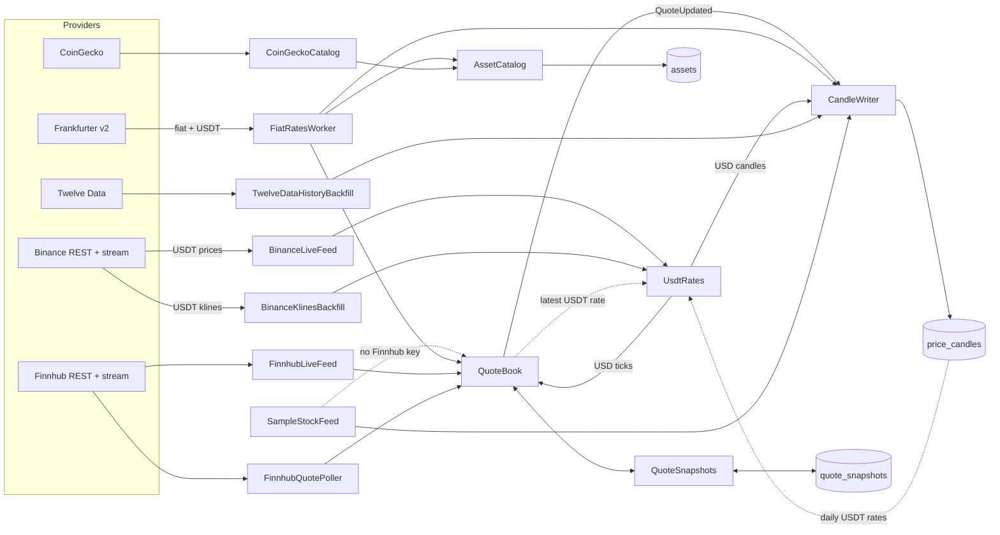

# Market data ingestion

> Brings prices for fiat currencies, coins, US stocks and index ETFs into Marketlens from five
> providers, keeps the latest price of every asset in memory and builds candle history in
> PostgreSQL, so every other feature reads one provider-neutral source.

**Status:** shipped (API, M2) · **Owner area:** `services/api/Marketlens.Api/MarketData/` ·
**Last updated:** 2026-11-09

## What it does

- Tracks 161 fiat currencies (every currency Frankfurter v2 publishes, including TND), the 31
  coins (30 from Binance, plus Tether) and 50 stocks/ETFs listed in [assets.json](../../services/api/Marketlens.Api/MarketData/assets.json).
- Prices everything in US dollars. USD is the pivot, always exactly 1. Binance quotes coins in
  USDT; ingestion multiplies those prices by the **USDT rate** (Tether's USD price, Frankfurter's
  daily USDT row, ≈ 0.9987 on 2026-11-08) before anything else sees them ([ADR 0007](../adr/0007-usdt-priced-in-usd.md)).
  Tether itself is a listed coin, priced daily.
- Keeps the **latest price** of each asset in memory, with the price its change is measured
  against (previous close, or 24 hours earlier for crypto), its source, time and freshness
  (`live`, `delayed`, `daily`).
- Keeps **candle history**: 1-minute for 3 days, 1-hour for 120 days, 1-day for 5 years.
- Needs **no API keys** to run: fiat and crypto come from keyless providers, and stocks fall back
  to clearly labelled **sample data** until a Finnhub key is set.
- Survives restarts (last prices are saved every minute and restored at startup) and provider
  outages (each worker retries with backoff and the last price ages visibly).

## Walkthrough

1. **Startup.** Migrations run ([DatabaseMigrator](../../services/api/Marketlens.Api/Data/DatabaseMigrator.cs)),
   then [AssetCatalog](../../services/api/Marketlens.Api/MarketData/AssetCatalog.cs#L22) writes the
   listed coins, stocks and ETFs into `assets`, after [AssetUniverse.FindProblems](../../services/api/Marketlens.Api/MarketData/AssetUniverse.cs#L47)
   has refused an invalid file (more than 50 streamed symbols, an ETF without the index it tracks,
   a coin that doesn't trade against USDT, a Binance symbol on Tether, or no Tether at all).
   [QuoteSnapshots.RestoreAsync](../../services/api/Marketlens.Api/MarketData/QuoteSnapshots.cs#L43)
   puts the last saved prices back in the quote book.
2. **Fiat and the USDT rate.** [FiatRatesWorker](../../services/api/Marketlens.Api/MarketData/FiatRatesWorker.cs#L15)
   syncs the currency list into the catalogue, then every hour reads the last seven days of rates
   for every currency **and USDT** ([RefreshAsync](../../services/api/Marketlens.Api/MarketData/FiatRatesWorker.cs#L73)):
   recent rates come first, so prices (and live crypto) appear after one request on a fresh
   database. Once per process it backfills five years (five yearly requests), unless both probes
   (`fiat:EUR` and Tether) already have that history. Each newest day becomes the price and the day
   before its reference ([ToLatestTicks](../../services/api/Marketlens.Api/MarketData/FiatRatesWorker.cs#L38)).
   [FrankfurterClient](../../services/api/Marketlens.Api/MarketData/FrankfurterClient.cs#L26)
   maps the `USDT` row to `crypto:USDT` and refuses a Tether price outside 0.5–1.5 USD.
3. **Crypto.** [BinanceLiveFeed](../../services/api/Marketlens.Api/MarketData/BinanceLiveFeed.cs#L17)
   holds one WebSocket to Binance's combined mini-ticker stream for all coins except Tether; each
   frame carries the last price and the price 24 hours earlier, in USDT. [UsdtRates.TryConvert](../../services/api/Marketlens.Api/MarketData/UsdtRates.cs#L33)
   multiplies both by the latest USDT rate; until a rate is known the tick is dropped (logged once
   per connection). [BinanceKlinesBackfill](../../services/api/Marketlens.Api/MarketData/BinanceKlinesBackfill.cs#L16)
   fills candle history at startup and every 6 hours: from the newest stored bucket, or from the
   retention window's start when the stored candles don't reach back that far
   ([FillStartUtc](../../services/api/Marketlens.Api/MarketData/BinanceKlinesBackfill.cs#L38): a fresh
   database, or live buckets written before the history). Each batch goes through
   [UsdtRates.ConvertAsync](../../services/api/Marketlens.Api/MarketData/UsdtRates.cs#L51), which
   prices every candle at the USDT rate of its own UTC day ([RateOn](../../services/api/Marketlens.Api/MarketData/UsdtRates.cs#L75)).
4. **Stocks and ETFs, with a Finnhub key.** [FinnhubLiveFeed](../../services/api/Marketlens.Api/MarketData/FinnhubLiveFeed.cs#L14)
   streams trades for up to 50 symbols; [FinnhubQuotePoller](../../services/api/Marketlens.Api/MarketData/FinnhubLiveFeed.cs#L118)
   polls every stock and ETF once per 2 minutes for its previous close (and prices any symbol the
   stream doesn't carry as `delayed`). [TwelveDataHistoryBackfill](../../services/api/Marketlens.Api/MarketData/TwelveDataClient.cs#L96)
   fills daily history when a Twelve Data key is set.
5. **Stocks and ETFs, without a key.** [SampleStockFeed](../../services/api/Marketlens.Api/MarketData/SampleStockFeed.cs#L15)
   writes five years of deterministic sample history (the same on every start) and moves prices
   every 5 seconds, all with source `sample`. When a key appears it removes its prices from the
   quote book ([QuoteBook.RemoveBySource](../../services/api/Marketlens.Api/MarketData/QuoteBook.cs))
   and deletes its candles. Sample prices carry the time they were made up, so left in place they
   would outrank a real price stamped with an earlier last trade (after the close) until the next
   trade; removed, each stock shows its real price within one poll cycle (2 minutes).
6. **Every accepted price** goes through [QuoteBook.Apply](../../services/api/Marketlens.Api/MarketData/QuoteBook.cs#L36),
   which keeps only newer prices and raises [QuoteUpdated](../../services/api/Marketlens.Api/MarketData/QuoteBook.cs#L29).
   [CandleWriter.Record](../../services/api/Marketlens.Api/MarketData/CandleWriter.cs#L92) rolls
   live and delayed prices into 1m/1h/1d buckets and flushes them every 5 seconds; daily fiat
   rates are not rolled into minute candles.
7. **Housekeeping.** Once a day [CandleWriter.PruneAsync](../../services/api/Marketlens.Api/MarketData/CandleWriter.cs#L157)
   deletes candles past their retention window; every minute `QuoteSnapshots` saves the quote book.

**Alternate flows**
- A provider is down or answers 429/418: the worker logs, waits with [ProviderBackoff](../../services/api/Marketlens.Api/MarketData/ProviderBackoff.cs#L8)
  (1 s doubling to 60 s, ±20% jitter, never shorter than `Retry-After`) and retries; the last
  price stays and its `asOfUtc` shows its age (`GET /api/v1/status` reports it).
- A provider sends an unexpected shape: the frame or response is skipped, or the worker logs and
  retries. No exception escapes a worker, because one would stop the whole API.
- Binance closes the stream (it does every 24 hours): the feed reconnects.
- The USDT history isn't loaded yet (a fresh database): fills whose candles fall before the first
  stored rate, or into a gap of more than seven days between rates, are skipped; the rest are
  written; the backfill logs one warning naming the day and retries with backoff.

## How it fits together

## Code walkthrough

- **Asset identity.** [AssetKey](../../services/api/Marketlens.Api/MarketData/AssetKey.cs) is
  `<class>:<symbol>` (`crypto:BTC`, `stock:BRK.B`); every layer passes keys, never provider symbols.
  `AssetKey.Tether` and [HasDailyPricesOnly](../../services/api/Marketlens.Api/MarketData/AssetKey.cs#L32)
  (fiat and Tether) are the one place that says which assets have daily prices only; history
  charts and the change basis read it.
- **USDT to USD.** [UsdtRates](../../services/api/Marketlens.Api/MarketData/UsdtRates.cs#L24) owns
  the conversion for both Binance paths, so a bucket written live and by the backfill is on one
  basis. A live tick uses the latest Tether quote; a candle uses the rate of its UTC day, or the
  latest one before it. Inside the stored history that rate may be at most `MaxRateAgeDays` (7)
  older, because a longer gap is history still loading (`UsdtHistoryIncompleteException`); after
  the newest rate, the newest one is used, as the live feed does while Frankfurter is late or down.
  Prices are rounded to 18 places so both paths store identical values. Volumes are in coins and
  are not converted.
- **Catalogue.** [AssetCatalog](../../services/api/Marketlens.Api/MarketData/AssetCatalog.cs#L22)
  is the only writer of `assets` and holds active assets in a frozen dictionary, so ingestion
  resolves a key to its database id without a query. Removed assets are deactivated, not deleted,
  so their history stays.
- **Adapters** are the only classes that know a provider's JSON: `FrankfurterClient`,
  `BinanceMarketDataClient` (+ `BinanceLiveFeed`), `FinnhubClient` (+ live feed and poller),
  `TwelveDataClient`, `CoinGeckoClient`. Each emits `PriceTick` or `CandleRow`. Keys travel in
  headers (`X-Finnhub-Token`, `Authorization: apikey …`, `x-cg-demo-api-key`), except Finnhub's
  WebSocket, which only accepts a query parameter; that URI is never logged.
- **Quote book.** [QuoteBook](../../services/api/Marketlens.Api/MarketData/QuoteBook.cs#L19) is a
  lock-free dictionary: an older or out-of-order tick is ignored, a tick without a reference keeps
  the known one, and [SetReferencePrice](../../services/api/Marketlens.Api/MarketData/QuoteBook.cs#L81)
  updates a previous close whatever the age of the quote that reported it.
- **Candles.** [CandleWriter.UpsertAsync](../../services/api/Marketlens.Api/MarketData/CandleWriter.cs#L132)
  sends parameterised arrays through `unnest` in batches of 5000 with `ON CONFLICT` merging: the
  first open is kept, high and low widen, close and volume take the newer value. That is why a
  backfill can be re-run and a live bucket can meet a backfilled one safely.
- **Registration order matters** ([Program.cs](../../services/api/Marketlens.Api/Program.cs)):
  hosted services start in order: migrator → Data Protection → catalogue → snapshots → candle
  writer → providers.

## Services and dependencies

| Service | Used for | Where in code | Config / env |
|---|---|---|---|
| Frankfurter v2 | fiat list, daily fiat rates and the daily USDT rate, no key | `FrankfurterClient`, `FiatRatesWorker` | `MarketData:Frankfurter:*` |
| Binance public market data | live crypto, klines; keyless, per-IP request weight | `BinanceMarketDataClient`, `BinanceLiveFeed`, `BinanceKlinesBackfill` | `BINANCE_MARKET_DATA_BASE_URL`, `BINANCE_STREAM_BASE_URL`, `MarketData:Binance:*` |
| Finnhub (free) | live US trades (≤50 symbols, 1 socket), quotes, 60 calls/min | `FinnhubClient`, `FinnhubLiveFeed`, `FinnhubQuotePoller` | `FINNHUB_API_KEY`, `MarketData:Finnhub:*` |
| Twelve Data (free) | daily stock/ETF history, 8 requests/min | `TwelveDataClient`, `TwelveDataHistoryBackfill` | `TWELVEDATA_API_KEY`, `MarketData:TwelveData:*` |
| CoinGecko Demo | coin logos only, one call a day; attribution required | `CoinGeckoClient`, `CoinGeckoCatalog` | `COINGECKO_DEMO_API_KEY` |
| PostgreSQL | assets, candles, snapshots | `Data/`, `CandleWriter`, `QuoteSnapshots` | `DATABASE_URL` |

Free-plan terms (display, redistribution, attribution) are summarised in
[provider-terms.md](../provider-terms.md); a public demo needs a
separate decision (D45).

## Data

- `assets`: `key` (unique), `class`, `symbol`, `name`, `logo_url`, `tracks` (ETFs),
  `provider_refs_*` (Binance symbol, CoinGecko id, Finnhub and Twelve Data symbols), `is_active`.
- `price_candles`: PK `(asset_id, interval, bucket_start_utc)`; `open_usd` … `close_usd`
  `numeric(38,18)`, `volume`, `source`. Retention by interval as above.
- `quote_snapshots`: one row per asset: `price_usd`, `reference_price_usd`, `as_of_utc`, `source`,
  `freshness`.
- Crypto candles and snapshots with source `binance` are in USD (converted at the USDT rate);
  Tether's daily candles have source `frankfurter`.
- Migrations: `InitialMarketData`, `AddQuoteSnapshotFreshness`, `AddForecasts`, and the data-only
  `RepriceCryptoInUsd` (deleted the USDT-basis `binance` candles and snapshots and all forecasts,
  which the workers then refilled) in [Data/Migrations](../../services/api/Marketlens.Api/Data/Migrations/).
  No personal data.

## API and contracts

Ingestion has no endpoints of its own; its output is read through
[live quotes](live-quotes.md), [currency conversion](currency-conversion.md) and
[price history](price-history-charts.md), and `GET /api/v1/status` reports each source's freshness
(`stockData` says `sample` or `finnhub`).

## Configuration

| Key | Default | Where |
|---|---|---|
| `MarketData:Frankfurter:BaseUrl` / `PollInterval` / `HistoryYears` | `https://api.frankfurter.dev/` / `01:00:00` / `5` | `appsettings.json` |
| `MarketData:Binance:MarketDataBaseUrl` / `StreamBaseUrl` / `GapFillInterval` | `data-api.binance.vision` / `data-stream.binance.vision` / `06:00:00` | `appsettings.json`; env overrides above |
| `MarketData:Finnhub:QuotePollCycle` | `00:02:00` | `FinnhubOptions` |
| `MarketData:TwelveData:RequestSpacing` / `TopUpInterval` | 8 s / 1 day | `TwelveDataOptions` |
| Asset universe | 31 coins (incl. Tether), 38 stocks, 12 ETFs | `MarketData/assets.json` |
| Accepted Tether price | 0.5–1.5 USD | `FrankfurterClient.MinTetherPriceUsd` / `MaxTetherPriceUsd` |
| Gap a candle's USDT rate may come from | 7 days | `UsdtRates.MaxRateAgeDays` |

All keys are optional; every env var is listed in [.env.example](../../.env.example).

## Errors and edge cases

- Invalid `assets.json`: the API refuses to start and lists every problem.
- Non-positive prices are rejected by the quote book; malformed frames are skipped.
- Binance blocks US IPs on `api.binance.com`; the keyless `.vision` hosts are the defaults, and the
  base URLs are configurable.
- Fiat rates from different central banks are published on different days; each currency keeps
  its own date.
- Frankfurter publishes USDT a day late, so today's crypto prices and buckets use yesterday's
  rate and are not revisited; a later refill of the same day uses that day's own rate (the
  difference is one day's USDT move, typically under 0.05%).
- An implausible Tether price (outside 0.5–1.5 USD) is refused and logged; the last accepted rate
  stays in use.
- A failed candle flush loses at most a few seconds of live buckets; the next prices and the
  backfills cover the gap. A failed shutdown save means the next start restores the save from the
  previous minute.

## Testing

- Tests in [Marketlens.Api.Tests/MarketData](../../services/api/Marketlens.Api.Tests/MarketData/):
  asset keys, universe rules, quote book, candle upsert/merge/prune, live aggregation, snapshots,
  backoff, and each adapter against fixtures. Frankfurter and Binance fixtures were recorded live;
  Finnhub, Twelve Data and CoinGecko fixtures follow the documented shapes (no keys yet).
- The test host answers provider HTTP from fixtures and removes the Binance WebSocket, so the
  suite never calls a live provider. It needs Docker (Testcontainers PostgreSQL).
- Run: `cd services/api && dotnet test`.
- USDT conversion: [UsdtRatesTests](../../services/api/Marketlens.Api.Tests/MarketData/UsdtRatesTests.cs)
  (tick and candle maths, rate on/before a day, gaps, live tick held back, incomplete history);
  [LiveCandlesAndSnapshotsTests](../../services/api/Marketlens.Api.Tests/MarketData/LiveCandlesAndSnapshotsTests.cs)
  (a backfilled BTC close equals the kline close × that day's rate; with only today's live bucket
  stored, a backfill restores the past); `FrankfurterClientTests` (USDT row, refused band, Tether
  priced daily). The Frankfurter fixture carries recorded USDT rows for 2026-10-01…11-08.
- By hand: `docker compose up -d`, `dotnet run --project Marketlens.Api`, then
  `curl localhost:5080/api/v1/status` and watch the sources fill in. Compare
  `curl "localhost:5080/api/v1/quotes?keys=crypto:BTC,crypto:USDT"` with Binance's BTCUSDT × the
  Tether price.

## Extending it

- **A new coin, stock or ETF:** one entry in `assets.json` (a coin needs `<SYMBOL>USDT` as its
  `binanceSymbol`; an ETF needs `tracks`; keep ≤50 `isStreamed`). Restart; the catalogue,
  backfills and live feeds pick it up, and coins are converted to USD automatically.
- **Another daily-priced asset** (another stablecoin from Frankfurter, a metal): extend
  `AssetKey.HasDailyPricesOnly`; charts and the change basis follow.
- **A new provider:** one adapter class that emits `PriceTick` / `CandleRow`, one worker with the
  same loop shape (catch everything except shutdown, back off), its options and env var in
  `Program.cs`, `.env.example` and this doc.
- **A new candle interval:** add it to `CandleInterval`, its column value, `RetentionWindow`,
  `BucketStart`, and `HistoryQuery.Plan`.

## Known limitations and follow-ups

- Finnhub, Twelve Data and CoinGecko adapters are tested only against documented shapes; re-record
  fixtures once P1 keys exist.
- One API instance (ADR 0003): the quote book is in memory; scaling out needs a shared cache.
- Live feeds broadcast unchanged prices too (a mini-ticker each second); harmless, could be trimmed.
- The USDT correction is daily; moves within a day are not followed (ADR 0007).
- Coins listed on Binance inside the 5-year window refetch their daily klines on every gap-fill
  run (2 pages each), because the stored history never reaches the window start.
- At startup the sample stock history write can deadlock with the daily prune
  (`40P01`, seen 2026-11-09); the write is idempotent and the stored history stays, but it is
  logged as a warning. Pre-existing; not yet fixed.

## Changelog

- 2026-11-08 — Created (marketlens-v1, M2).
- 2026-11-09 — Crypto priced in real USD at the daily USDT rate; Tether listed; self-healing
  klines gap-fill; migration `RepriceCryptoInUsd` (price-and-forecast-accuracy, ADR 0007).
- 2026-11-09 — Fix: when a Finnhub key is set, sample prices are removed from the quote book too,
  so real quotes from before the close replace them (they had stayed until the next trade).
