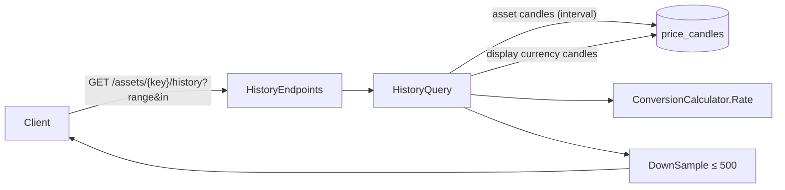

# Price history charts

> Gives each asset (or any pair) a price series for 1D, 1W, 1M, 3M, 1Y and 5Y in the user's display
> currency, small enough to draw quickly, and lets the visitor compare any two past points on it.

**Status:** shipped on the web (M3); mobile in M7 · **Owner area:**
`services/api/Marketlens.Api/History/`, `apps/web/src/components/PriceChart.tsx` ·
**Last updated:** 2026-11-16

## What it does

- Each range reads the finest stored candle interval that covers it: 1D → 1-minute candles shown
  every 5 minutes; 1W and 1M → hourly; 3M, 1Y, 5Y → daily.
- Points are converted into the display currency with that currency's price **at the same
  moment**; fiat display currencies have daily rates, so an hourly chart in euros uses each day's
  euro rate.
- Fiat and Tether have daily rates only (`AssetKey.HasDailyPricesOnly`), so their 1D, 1W and 1M
  return daily points (`interval: "1d"`) whatever they are shown in; the client explains "daily
  rates only". Crypto history is in real USD (USDT converted at each day's rate, ADR 0007).
- At most 500 points per series; the newest point always survives down-sampling.
- **Comparison** (web): drag across a chart, or move the **start point** and **end point** sliders
  under it, to compare two past points. A panel shows both prices in the display currency, the %
  change with ▲/▼ and the difference; the span is shaded on the chart. Only past closes can be
  picked, never the forecast days drawn after the last close. It works on every asset chart and
  resets when the range, the display currency or the asset changes.

## Walkthrough

1. The client calls `GET /api/v1/assets/crypto:BTC/history?range=5Y&in=fiat:EUR`
   ([GetAssetHistory](../../services/api/Marketlens.Api/History/HistoryEndpoints.cs#L23)), or
   `GET /api/v1/conversions/history?from=crypto:ETH&to=crypto:BTC&range=1M`
   ([GetConversionHistory](../../services/api/Marketlens.Api/History/HistoryEndpoints.cs#L45)).
2. [HistoryQuery.ReadAsync](../../services/api/Marketlens.Api/History/HistoryQuery.cs#L77) picks
   the interval (`Plan`), reads the asset's closes from `price_candles` (a primary-key range scan),
   and the display currency's closes from a week earlier (to cover weekends).
3. Each asset close is paired with the latest display close at or before it and divided by
   `ConversionCalculator.Rate`; points before the display currency's first price are dropped.
4. [DownSample](../../services/api/Marketlens.Api/History/HistoryQuery.cs#L65) keeps the last
   point of each group so at most 500 remain.
5. The answer is `{interval, in, points: [{t, close}]}` with closes as decimal strings.

**Alternate flows:** unknown range → 400 `invalid-parameter` (`range`); unknown asset → 404; no
candles yet (fresh database) → an empty `points` array.

### Comparing two points (web)

1. The visitor presses on the chart and drags. [PriceChart](../../apps/web/src/components/PriceChart.tsx#L288) captures the
   pointer (so the drag survives leaving the chart) and maps its x position through the plot area
   to the nearest past close ([nearestHistoryIndex](../../apps/web/src/components/PriceChart.tsx#L100)), clamped to the history.
2. While dragging, the span between the two points is shaded with a `ReferenceArea`; on release the
   [ComparisonSummary](../../apps/web/src/components/PriceChart.tsx#L537) panel shows the earlier point, the later point, the %
   change and the difference, and an `aria-live` region reads the same sentence once.
3. [compareCloses](../../apps/web/src/components/PriceChart.tsx#L118) computes the difference and the % change exactly on the
   two decimal strings the API served (BigInt arithmetic, four decimals, half away from zero). Both
   prices are the server's; the result is display only (D1 of roadmap-and-fundamentals).
4. From the keyboard or a screen reader, the [ComparisonControls](../../apps/web/src/components/PriceChart.tsx#L484) sliders do
   the same: arrows, Page keys, Home and End step through past closes, each value read as
   "time, price currency". Escape on a slider, or **Clear comparison**, clears it.

A press without a drag clears the comparison. A chart with one point offers no comparison.

## How it fits together



```mermaid
sequenceDiagram
  actor Visitor
  participant Chart as PriceChart (web)
  participant Panel as ComparisonSummary
  Visitor->>Chart: press and drag (or move a slider)
  Chart->>Chart: x position → nearest past close (nearestHistoryIndex)
  Chart->>Chart: shade the span (ReferenceArea)
  Visitor->>Chart: release
  Chart->>Panel: earlier and later point (decimal strings from the API)
  Panel->>Panel: compareCloses → difference, % change
  Panel-->>Visitor: both prices, ▲/▼ %, difference; aria-live sentence
```

## Code walkthrough

- **Endpoints:** [HistoryEndpoints](../../services/api/Marketlens.Api/History/HistoryEndpoints.cs)
  validate key, range and `in` (shared `QuoteEndpoints.TryParseDisplayCurrency`), then delegate.
- **Query:** [HistoryQuery](../../services/api/Marketlens.Api/History/HistoryQuery.cs#L28) owns the
  range table, the as-of join (a single forward pass over two sorted lists) and down-sampling.
  USD points are rounded like every other price.
- **Web chart:** [PriceChart](../../apps/web/src/components/PriceChart.tsx) (Recharts area line in
  the ink colour over a faint accent fill, compact axis labels, a tooltip in the visitor's language,
  `role="img"` with a first-to-last sentence for screen readers, and a caption when a short range
  falls back to daily points). Times in the tooltip and the comparison follow the points'
  interval: with the hour for minute and hour points, the date alone for daily ones. The comparison
  lives here too: its state (`Comparison`, stored by time and scoped to asset, range and currency),
  the pointer handlers, the sliders and the summary panel. Recharts' own keyboard layer is off, and
  `index.css` hides the focus outline Recharts' `tabindex="-1"` layers get on a mouse press. The asset page ([AssetPage](../../apps/web/src/pages/AssetPage.tsx))
  holds the range buttons and shows an asset in US dollars when it is the display currency itself.
- **Where the candles come from:** see [market data ingestion](market-data-ingestion.md).

## Services and dependencies

| Service | Used for | Where in code | Config / env |
|---|---|---|---|
| PostgreSQL `price_candles` | the series | `HistoryQuery` | `DATABASE_URL` |

## Data

Reads `price_candles` by its primary key `(asset_id, interval, bucket_start_utc)`; stores nothing.

## API and contracts

| Method + path | Returns |
|---|---|
| `GET /api/v1/assets/{key}/history?range=1D\|1W\|1M\|3M\|1Y\|5Y&in=` (default `1M`, `fiat:USD`) | `{interval: "1m"\|"1h"\|"1d", in, points: {t, close}[]}` |
| `GET /api/v1/conversions/history?from=&to=&range=` | the same shape, `in` = `to` |

## Configuration

None beyond the retention windows in `CandleWriter.RetentionWindow` (constants).

## Errors and edge cases

- Weekends and holidays: stock and fiat series simply have no point for those days.
- Fresh clone: crypto history fills within minutes (Binance backfill), fiat within seconds, stocks
  immediately from sample data.

## Testing

[HistoryStatusLocaleTests](../../services/api/Marketlens.Api.Tests/Http/HistoryStatusLocaleTests.cs)
(range table, down-sampling, AAPL 1Y daily, conversion into EUR from the first recorded rate, fiat
1D daily, pair history, bad range). By hand:
`curl "localhost:5080/api/v1/assets/crypto:BTC/history?range=1D"`.

The comparison: [PriceChart.test.ts](../../apps/web/src/components/PriceChart.test.ts)
(`nearestHistoryIndex` never picks a forecast day; `compareCloses` exact difference and %, tiny
prices, zero, rounding) and the E2E test "compares two past points by dragging, with the sliders,
and clears" in [app.spec.ts](../../apps/web/e2e/app.spec.ts), plus the axe pass on
`/assets/crypto:BTC`. By hand: open Bitcoin on 1M, drag from an early point into the forecast band
(it stops at the last close), then Tab to **Start point** and use the arrow keys.

## Extending it

A new range: add it to `ChartRange`, `TryParseRange` and `Plan`, then regenerate the contract and
types. A finer interval for a range needs that interval stored and retained (`CandleWriter`).

## Known limitations and follow-ups

- No live "last point": the newest minute bucket is written every 5 seconds; clients can append the
  live quote themselves.
- The comparison is web only; mobile comes with M7. It compares closes of the chart's points, so on
  5Y (daily points, down-sampled to 500) a point can stand for a few days.

## Changelog

- 2026-11-08 — Created (marketlens-v1, M2).
- 2026-11-08 — Web chart (M3).
- 2026-11-09 — The web chart draws the forecast range on 1W / 1M / 3M; see
  [forecasts.md](forecasts.md) (M4).
- 2026-11-16 — Comparison of two past points: drag, sliders, summary panel, exact % and difference
  (roadmap-and-fundamentals, PR B, v1-D58). Tooltip times follow the points' interval.
- 2026-11-09 — Daily-only rule covers Tether and no longer depends on the display currency, so a
  daily asset shown in a coin is no longer empty on short ranges (price-and-forecast-accuracy).
