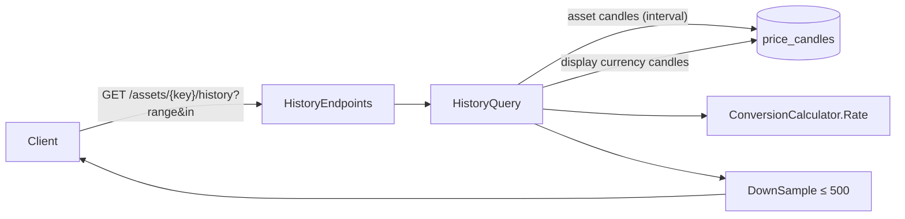

# Price history charts

> Gives each asset (or any pair) a price series for 1D, 1W, 1M, 3M, 1Y and 5Y in the user's display
> currency, small enough to draw quickly.

**Status:** API shipped (M2); chart components in M3 (web) and M7 (mobile) · **Owner area:**
`services/api/Marketlens.Api/History/` · **Last updated:** 2026-11-08

## What it does

- Each range reads the finest stored candle interval that covers it: 1D → 1-minute candles shown
  every 5 minutes; 1W and 1M → hourly; 3M, 1Y, 5Y → daily.
- Points are converted into the display currency with that currency's price **at the same
  moment**; fiat display currencies have daily rates, so an hourly chart in euros uses each day's
  euro rate.
- Fiat shown in fiat has daily rates only, so 1D and 1W of `fiat:EUR` return daily points
  (`interval: "1d"`); the client explains "daily rates only".
- At most 500 points per series; the newest point always survives down-sampling.

## Walkthrough

1. The client calls `GET /api/v1/assets/crypto:BTC/history?range=5Y&in=fiat:EUR`
   ([GetAssetHistory](../../services/api/Marketlens.Api/History/HistoryEndpoints.cs#L23)), or
   `GET /api/v1/conversions/history?from=crypto:ETH&to=crypto:BTC&range=1M`
   ([GetConversionHistory](../../services/api/Marketlens.Api/History/HistoryEndpoints.cs#L45)).
2. [HistoryQuery.ReadAsync](../../services/api/Marketlens.Api/History/HistoryQuery.cs#L77) picks
   the interval (`Plan`), reads the asset's closes from `price_candles` (a primary-key range scan),
   and the display currency's closes from a week earlier (to cover weekends).
3. Each asset close is paired with the latest display close at or before it and divided by
   `ConversionCalculator.Rate`; points before the display currency's first price are dropped.
4. [DownSample](../../services/api/Marketlens.Api/History/HistoryQuery.cs#L65) keeps the last
   point of each group so at most 500 remain.
5. The answer is `{interval, in, points: [{t, close}]}` with closes as decimal strings.

**Alternate flows:** unknown range → 400 `invalid-parameter` (`range`); unknown asset → 404; no
candles yet (fresh database) → an empty `points` array.

## How it fits together

## Code walkthrough

- **Endpoints:** [HistoryEndpoints](../../services/api/Marketlens.Api/History/HistoryEndpoints.cs)
  validate key, range and `in` (shared `QuoteEndpoints.TryParseDisplayCurrency`), then delegate.
- **Query:** [HistoryQuery](../../services/api/Marketlens.Api/History/HistoryQuery.cs#L28) owns the
  range table, the as-of join (a single forward pass over two sorted lists) and down-sampling.
  USD points are rounded like every other price.
- **Where the candles come from:** see [market data ingestion](market-data-ingestion.md).

## Services and dependencies

| Service | Used for | Where in code | Config / env |
|---|---|---|---|
| PostgreSQL `price_candles` | the series | `HistoryQuery` | `DATABASE_URL` |

## Data

Reads `price_candles` by its primary key `(asset_id, interval, bucket_start_utc)`; stores nothing.

## API and contracts

| Method + path | Returns |
|---|---|
| `GET /api/v1/assets/{key}/history?range=1D\|1W\|1M\|3M\|1Y\|5Y&in=` (default `1M`, `fiat:USD`) | `{interval: "1m"\|"1h"\|"1d", in, points: {t, close}[]}` |
| `GET /api/v1/conversions/history?from=&to=&range=` | the same shape, `in` = `to` |

## Configuration

None beyond the retention windows in `CandleWriter.RetentionWindow` (constants).

## Errors and edge cases

- Weekends and holidays: stock and fiat series simply have no point for those days.
- Fresh clone: crypto history fills within minutes (Binance backfill), fiat within seconds, stocks
  immediately from sample data.

## Testing

[HistoryStatusLocaleTests](../../services/api/Marketlens.Api.Tests/Http/HistoryStatusLocaleTests.cs)
(range table, down-sampling, AAPL 1Y daily, conversion into EUR from the first recorded rate, fiat
1D daily, pair history, bad range). By hand:
`curl "localhost:5080/api/v1/assets/crypto:BTC/history?range=1D"`.

## Extending it

A new range: add it to `ChartRange`, `TryParseRange` and `Plan`, then regenerate the contract and
types. A finer interval for a range needs that interval stored and retained (`CandleWriter`).

## Known limitations and follow-ups

- No live "last point": the newest minute bucket is written every 5 seconds; clients can append the
  live quote themselves.

## Changelog

- 2026-11-08 — Created (marketlens-v1, M2).
