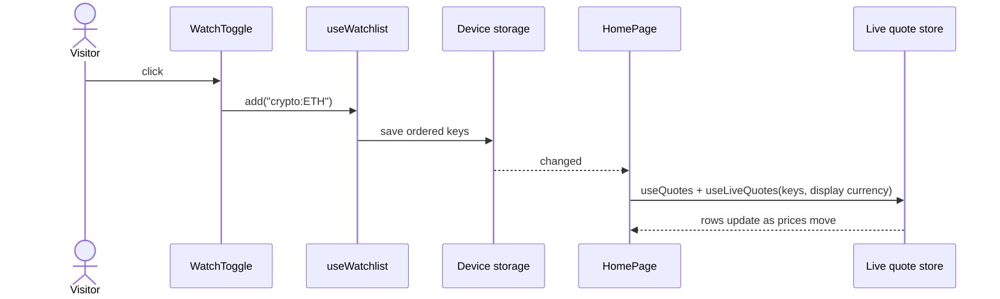

# Watchlists

> Lets a visitor keep the currencies, coins and stocks they follow at the top of the home page, with
> live prices, without creating an account.

**Status:** shipped on the web, saved on the device (M3); account sync in M5 · **Owner area:**
`apps/web/src/watchlist/` · **Last updated:** 2026-11-08

## What it does

- A star on every asset row and a **Watch** button on every asset page add or remove the asset.
- The home page lists watched assets in the order they were added, with live prices in the display
  currency, their change and freshness.
- An empty watchlist explains itself and offers five starters (Bitcoin, Ethereum, Euro, Apple, the
  S&P 500 ETF).
- Saved on this device (all tabs stay in step); up to 200 assets, the limit the account version will
  have. Signing in will merge it into the account (D14, D38).

## Walkthrough

1. The visitor clicks the star on Ethereum ([WatchToggle](../../apps/web/src/components/AssetTable.tsx)),
   which calls `add` on [useWatchlist](../../apps/web/src/watchlist/useWatchlist.ts).
2. The hook writes the ordered key list to device storage
   ([deviceStorage](../../apps/web/src/settings/deviceStorage.ts)), which notifies every component
   and other tabs.
3. The home page ([HomePage](../../apps/web/src/pages/HomePage.tsx)) maps the keys to assets, loads
   their quotes (`useQuotes`) and keeps them live (`useLiveQuotes`); each row reads its own price
   from the live quote store, so one price update re-renders one row.
4. The star shows its state with `aria-pressed` and an accessible name ("Remove Ethereum from your
   watchlist").

## How it fits together

## Code walkthrough

- [useWatchlist](../../apps/web/src/watchlist/useWatchlist.ts): `keys`, `add`, `remove`, `has`;
  `parseWatchlist` drops anything that isn't an asset key and duplicates, so a corrupted or edited
  value can't break the page.
- [deviceStorage](../../apps/web/src/settings/deviceStorage.ts): `useSyncExternalStore` over
  `localStorage` + the `storage` event; falls back to memory when storage is blocked.
- Live prices: [liveQuotes](../../apps/web/src/api/liveQuotes.ts) shares one SignalR connection and
  counts watchers, so the watchlist and another table showing Bitcoin share one subscription.

## Services and dependencies

| Service | Used for | Where in code | Config / env |
|---|---|---|---|
| Browser `localStorage` | the list | `deviceStorage.ts` | key `marketlens.watchlist` |
| API quotes + live hub | prices | `queries.ts`, `liveQuotes.ts` | see [live quotes](live-quotes.md) |

## Data

`marketlens.watchlist`: a JSON array of asset keys, newest last. On this device only.

## API and contracts

None yet; M5 adds `GET`/`PUT /api/v1/me/watchlist`.

## Configuration

`MAX_WATCHLIST_SIZE` = 200 in `useWatchlist.ts` (matches the server limit planned for M5).

## Errors and edge cases

- An asset removed from the catalogue simply disappears from the list (it has no row to show).
- Storage blocked → the list lasts for the session.

## Testing

[useWatchlist.test.ts](../../apps/web/src/watchlist/useWatchlist.test.ts) (parse, order, duplicates,
persistence, 200 cap); E2E "starts empty, takes a suggestion, and keeps it after a reload". By hand:
star a few rows, reload, open a second tab.

## Extending it

Reordering: add a `move(key, toIndex)` to the hook and drag handles to the table. Account sync (M5):
`useWatchlist` reads the server list when signed in and merges the device list once (D38).

## Known limitations and follow-ups

- No reordering yet; no sync across devices until M5.

## Changelog

- 2026-11-08 — Created (marketlens-v1, M3).
