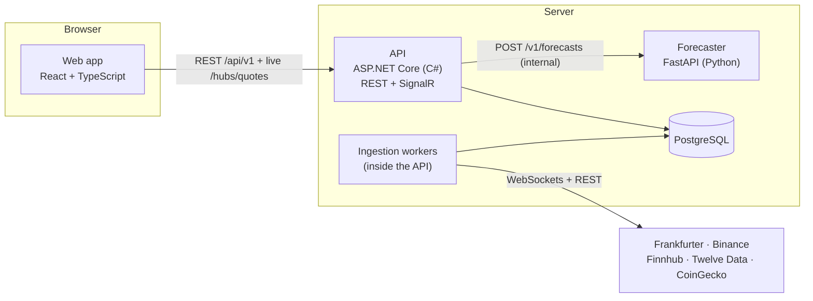
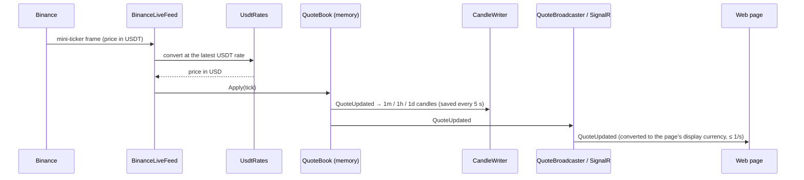

# Marketlens project guide

A tour of the whole project: what it does and what it is good at, the languages and technologies
it uses and why, and what every part of the code does. Read it top to bottom once; afterwards use
the [feature docs](features/README.md) for the detail of one feature.

**Contents:** [What Marketlens is](#what-marketlens-is) ·
[Languages and technologies](#languages-and-technologies) · [The big picture](#the-big-picture) ·
[Repository map](#repository-map) · [The API](#the-api-net) ·
[The forecaster](#the-forecaster-python) ·
[The web app](#the-web-app-react) · [The shared package](#the-shared-package) ·
[Data model](#data-model) · [Testing](#testing) · [Running and CI](#running-it-and-ci) ·
[What is not built yet](#what-is-not-built-yet) · [Where to go next](#where-to-go-next)

## What Marketlens is

Marketlens is an open-source (MIT) app for everyday people who check exchange rates, convert
money and follow a few coins and stocks. It is **not** a trading tool and never says buy or sell.

What it does:

- **Live prices** for 161 currencies, 30 major coins plus Tether, and 50 US stocks and index ETFs.
  Coins update every second; currencies use the daily reference rates central banks publish.
- **Convert** any amount between any two of them (0.25 BTC → Tunisian dinar, EUR → JPY, ETH → BTC).
- **Charts** from one day to five years, in any display currency.
- **Forecast ranges** for the next seven days, with a measured track record of how often past
  ranges held and whether the model did better than "the price stays where it is".
- **Three languages** (English, French, German) and a light and dark theme; a watchlist kept on
  the device.

What it specialises in, and what makes it different from a price widget:

1. **One source of truth for prices.** Only the server talks to the data providers and only one
   class computes a conversion. The web app (and the mobile app later) only display numbers, so
   they can never disagree.
2. **Honest numbers.** Every price shows where it came from and how old it is ("Live", "Rate of
   Nov 8", "Sample data"). Crypto prices are in real US dollars, corrected for USDT not being
   exactly one dollar. Forecasts are ranges, not single "predicted" prices, sized so that "80%"
   really holds about 80% of the time, and the page says plainly when the model did no better than
   assuming no change.
3. **Free to run.** It works with no API keys at all (currencies and crypto come from keyless
   providers; stocks fall back to clearly labelled sample data), and the free tiers of the keyed
   providers are enough for real stock data.
4. **Built to be read.** Each feature lives in one folder, every decision is written down
   ([adr/](adr/), [CONTEXT.md](CONTEXT.md)), and every finished feature has a walkthrough in
   [features/](features/).

## Languages and technologies

The project uses three languages, each where it is strongest.

| Language | Where | Why this one |
|---|---|---|
| **C#** (.NET 10) | `services/api/` | Fast, strongly typed server with first-class support for real-time connections (SignalR), background workers and database access. `decimal` keeps money exact. |
| **Python** 3.12 | `services/forecaster/` | The best ecosystem for statistics and forecasting (statsforecast, NumPy, pandas). |
| **TypeScript** 6.0 | `apps/web/`, `packages/shared/` | JavaScript with types, so the browser code is checked before it runs, and the API's types are generated into it. |
| **SQL** (PostgreSQL) | through EF Core in the API | Stores prices, history and forecasts. |

### Server: the API

| Technology | What it is | What Marketlens uses it for |
|---|---|---|
| **ASP.NET Core 10, minimal APIs** | Microsoft's web framework; "minimal APIs" map a URL straight to a function, without controller classes. | Every `/api/v1/...` endpoint. |
| **SignalR** | Real-time messaging over WebSockets. | `/hubs/quotes`: pushes price changes to open pages, at most once a second per asset. |
| **Hosted services** (`BackgroundService`) | Long-running loops that start with the API. | The ingestion workers (provider streams and pollers), the candle writer, the forecast scheduler. |
| **Entity Framework Core 10 + Npgsql** | The .NET object-relational mapper and its PostgreSQL driver. | Tables as C# classes, LINQ queries, and migrations (versioned schema changes applied at startup). |
| **ASP.NET Core Data Protection** | Key management for encrypted cookies and tokens. | Ready for sign-in (planned); its keys are stored in the database. |
| **OpenAPI** | A machine-readable description of every endpoint. | Generated at build time, committed as `services/api/openapi/v1.json`, and turned into TypeScript types for the web. |
| **xUnit v3, Testcontainers** | Test framework; throw-away Docker containers for tests. | 200 tests, many against a real PostgreSQL started in Docker for the test run. |

### Forecasting service

| Technology | What it is | What Marketlens uses it for |
|---|---|---|
| **FastAPI** + **Pydantic** | A Python web framework with typed request validation. | One internal endpoint, `POST /v1/forecasts`. |
| **statsforecast** (Nixtla) | Fast classical forecasting models. | AutoETS (exponential smoothing), AutoTheta, AutoARIMA and Naive ("no change"). |
| **NumPy, pandas** | Numerical arrays and tables. | Log prices, backtests, the range calibration. |
| **uv, Ruff, mypy, pytest** | Package manager, linter/formatter, strict type checker, test runner. | Reproducible installs and checks in CI. |

### Web app

| Technology | What it is | What Marketlens uses it for |
|---|---|---|
| **React 19** | UI library: the page is built from components. | Every screen. |
| **Vite 8** | Dev server and bundler. | Fast local development; splits pages so each loads on demand. |
| **Tailwind CSS 4** | Utility-class styling. | All styling, with the colours and sizes from the shared design tokens. |
| **TanStack Query 5** | Server-state cache: fetching, caching, retries, loading and error states. | Every REST call (`apps/web/src/api/queries.ts`). |
| **@microsoft/signalr** | The SignalR client. | The live price connection. |
| **openapi-fetch** | A tiny typed HTTP client built from the OpenAPI types. | Calls are type-checked against the real API contract. |
| **React Router 8** | URL routing. | `/`, `/markets/:market`, `/assets/:key`, `/convert`, `/data-sources`, `/how-forecasts-work`. |
| **Recharts 3** | Charts for React. | The price chart and the shaded forecast bands. |
| **i18next / react-i18next** | Translations. | English, French and German, with type-checked message keys. |
| **Vitest, Testing Library, Playwright, axe** | Unit tests, component tests, browser end-to-end tests, accessibility checks. | 69 unit tests and 22 end-to-end tests. |

### Data, infrastructure and tooling

| Technology | Use |
|---|---|
| **PostgreSQL 17** | The only database: assets, candles, latest-price snapshots, forecasts. |
| **Docker Compose** | Runs everything locally with one command: postgres, mailpit (test mail server), api, forecaster, web (nginx). |
| **nginx** | Serves the built web app and forwards `/api` and `/hubs` to the API, so the browser sees one origin. |
| **GitHub Actions** | CI: TypeScript, .NET and Python checks plus a secret scan (gitleaks) on every push. |
| **npm workspaces** | One install for the web app and the shared package. |

### Data providers

| Provider | Data | Key needed |
|---|---|---|
| **Frankfurter** | 161 currencies' daily reference rates, and the daily USDT rate | no |
| **Binance** (public market data) | live crypto prices and crypto history | no |
| **Finnhub** | live US stock and ETF prices | yes (free) |
| **Twelve Data** | daily stock and ETF history | yes (free) |
| **CoinGecko** | coin logos only | yes (free, optional) |

## The big picture



The rule that shapes everything: **the server decides, the clients display.** The browser sends
intent ("show me BTC in euros"); the API fetches, converts, stores and answers. The browser never
calls a provider and never does price maths.

### How a live price reaches the screen



### How a forecast is made

Every 10 minutes the API looks for assets with a new complete daily close. For each, it sends the
last two years of closes to the forecaster, which backtests several models, keeps one only if it
beats "no change", forecasts the next seven days and sizes the ranges from how far the price really
moved. The API stores the answer; the asset page reads it. Details in
[features/forecasts.md](features/forecasts.md).

## Repository map

```text
apps/web/                    the website (React + TypeScript)
  src/app/                   layout, routes, search box, settings menu
  src/pages/                 one file per page
  src/components/            price chart, asset table, price/change/freshness pieces
  src/api/                   typed API client, data-fetching hooks, live price store
  src/conversions/           the converter panel
  src/forecasts/             the forecast sentence under the chart
  src/settings/              language, currency and theme; device storage
  src/watchlist/             the on-device watchlist
  e2e/                       Playwright end-to-end tests
packages/shared/             code both apps share
  src/tokens.ts              design tokens (colours, type scale, spacing)
  src/format.ts              number, percent and date formatting per language
  src/i18n/                  en / fr / de messages
  src/api/schema.ts          TypeScript types generated from the API contract (never edited)
services/api/
  Marketlens.Api/            the API, one folder per feature
  Marketlens.Api.Tests/      its tests, mirroring those folders
  openapi/v1.json            the committed API contract
services/forecaster/
  forecaster/                app.py (HTTP), forecast.py (models), backtest.py (scoring, ranges)
  tests/                     pytest suite and the recorded contract fixtures
docs/                        this guide, CONTEXT.md, architecture.md, adr/, features/, api/
docker-compose.yml           the whole stack locally
.github/workflows/ci.yml     continuous integration
```

## The API (.NET)

`services/api/Marketlens.Api/` is one project organised by **feature folders**
([ADR 0002](adr/0002-single-api-with-feature-folders.md)): everything about quotes is in `Quotes/`,
everything about forecasts in `Forecasts/`, and so on. There are no separate "controllers",
"services" and "repositories" projects; a feature's endpoint, rules and workers sit together.

### Startup: `Program.cs`

[Program.cs](../services/api/Marketlens.Api/Program.cs) wires everything with dependency injection
(each class asks for what it needs in its constructor; the container supplies it). The order of
hosted services matters, because they start in registration order:

1. `DatabaseMigrator` applies pending database migrations.
2. Data Protection and `AssetCatalog` (writes the list of tracked assets into the database).
3. `QuoteSnapshots` restores the last known prices, so a restart isn't an empty app.
4. `CandleWriter`, then the provider workers.

It then maps the `/api/v1` endpoints and the `/hubs/quotes` hub.

### `Http/`: how the API speaks HTTP

[ApiConventions.cs](../services/api/Marketlens.Api/Http/ApiConventions.cs) holds the cross-cutting
rules in one place: prices travel as **decimal strings** in JSON (a JavaScript number can't hold
`0.000012345678` exactly), enums as lower-case words, errors as **RFC 9457 problem details** (a
standard JSON error shape, listed in [api/problems.md](api/problems.md)), the OpenAPI document,
and a **rate limit** of 600 requests per minute per IP on public endpoints.

### `MarketData/`: getting prices in

This is the largest folder. It turns five different providers into one provider-neutral stream of
USD prices. Full walkthrough: [features/market-data-ingestion.md](features/market-data-ingestion.md).

| File | What it does |
|---|---|
| `AssetKey.cs` | The identity of every asset: `class:symbol`, e.g. `fiat:EUR`, `crypto:BTC`, `stock:AAPL`, `etf:SPY`. Also says which assets only have daily prices (fiat and Tether). |
| `AssetUniverse.cs` + `assets.json` | The list of coins, stocks and ETFs to track, checked at startup (a bad entry stops the API with a clear message). Adding an asset is one line in `assets.json`. |
| `AssetCatalog.cs` | Owns the `assets` table and keeps the active assets in memory. |
| `PriceTick.cs` | The one shape every adapter emits: asset, USD price, reference price (for the change %), time, source, freshness. |
| `QuoteBook.cs` | The latest USD price of every asset, **in memory**. Accepts only newer prices and raises `QuoteUpdated`. Everything that reads "current price" reads here, never a provider. |
| `FrankfurterClient.cs` + `FiatRatesWorker.cs` | Currencies: the list, five years of daily rates once, then the last week every hour. Also the daily **USDT rate**. |
| `BinanceLiveFeed.cs` | One WebSocket for every coin's live price (Binance quotes in USDT). |
| `BinanceMarketDataClient.cs` + `BinanceKlinesBackfill.cs` | Crypto history ("klines" = candles): fills gaps at startup and every 6 hours, and rebuilds a missing past. |
| `UsdtRates.cs` | Converts Binance's USDT prices into real US dollars, live at the latest rate and in history at each day's rate ([ADR 0007](adr/0007-usdt-priced-in-usd.md)). |
| `FinnhubClient.cs` + `FinnhubLiveFeed.cs` | Stocks and ETFs: a live trade stream for up to 50 symbols, and a poller for previous closes. |
| `TwelveDataClient.cs` | Five years of daily stock and ETF history. |
| `SampleStockFeed.cs` | Without a Finnhub key: deterministic, clearly labelled sample prices so the app still works. |
| `CoinGeckoCatalog.cs` | Coin logos, once a day. |
| `CandleWriter.cs` | Rolls live prices into 1-minute, 1-hour and 1-day candles, writes them in batches, and prunes old ones (3 days / 120 days / 5 years). |
| `QuoteSnapshots.cs` | Saves the quote book every minute and restores it at startup. |
| `ProviderBackoff.cs` | Retry delays after a provider error: 1 s doubling to 60 s, with jitter. |

Every worker follows the same loop: try, and on any error log it, wait with backoff and try again.
An exception escaping a background service would stop the whole API, so none is allowed to.

### `Conversions/`: the reference implementation

[ConversionCalculator.cs](../services/api/Marketlens.Api/Conversions/ConversionCalculator.cs) is
the **only** place a cross rate is computed. Every asset has a USD price, so any pair is a
division: 1 BTC in TND = price of BTC in USD ÷ price of TND in USD. The result is as old as its
older leg and as fresh as its slower one (a live coin against a daily currency rate reports
"daily"). [ConversionEndpoints.cs](../services/api/Marketlens.Api/Conversions/ConversionEndpoints.cs)
validates the request, calls the calculator and answers. New features copy this shape: endpoint →
pure rule class → typed response. Doc: [features/currency-conversion.md](features/currency-conversion.md).

### `Quotes/`: current prices and the live hub

- [QuoteEndpoints.cs](../services/api/Marketlens.Api/Quotes/QuoteEndpoints.cs): `GET /api/v1/assets`
  (the catalogue, paged) and `GET /api/v1/quotes?keys=…&in=…` (up to 50 latest prices in one
  display currency).
- [QuoteReader.cs](../services/api/Marketlens.Api/Quotes/QuoteReader.cs): turns a quote-book entry
  into a quote in the display currency, and says what the change % compares with (previous close,
  or the last 24 hours for crypto).
- [QuotesHub.cs](../services/api/Marketlens.Api/Quotes/QuotesHub.cs): the SignalR hub. A page calls
  `Subscribe(keys, in)` and receives `QuoteUpdated` messages. Limits protect the server: 50 assets
  per connection, 5 connections per IP.
- [QuoteBroadcaster.cs](../services/api/Marketlens.Api/Quotes/QuoteBroadcaster.cs): sends at most one
  update per asset per second, converted for each group of watchers.

Doc: [features/live-quotes.md](features/live-quotes.md).

### `History/`: charts

[HistoryQuery.cs](../services/api/Marketlens.Api/History/HistoryQuery.cs) picks the candle size for
a range (1D → 1-minute, 1W/1M → hourly, longer → daily), reads it from PostgreSQL, converts each
point with the display currency's price at that moment, and keeps at most 500 points. Doc:
[features/price-history-charts.md](features/price-history-charts.md).

### `Forecasts/`: scheduling, storing and scoring forecasts

| File | What it does |
|---|---|
| `ForecastScheduler.cs` | Every 10 minutes: finds assets with a newer complete daily close, sends their last 730 daily closes to the forecaster, stores the answer. One failing asset never stops the others. |
| `ForecasterClient.cs` | The typed HTTP client for the forecaster, plus a check that every answer is sane (one point per day, ranges positive and nested). |
| `ForecastEvaluator.cs` | Once a forecast day has passed, compares it with the real close: inside the 80% range? how far off? how far off was "no change"? This builds the **live track record**. |
| `ForecastEndpoints.cs` | `GET /api/v1/assets/{key}/forecast?in=`: the latest forecast in the display currency, with its track record (from the backtest until enough live results exist). |

### `Locale/`, `Status/`, `Data/`

- [LocaleSuggester.cs](../services/api/Marketlens.Api/Locale/LocaleSuggester.cs) suggests a language
  and currency from the browser's `Accept-Language` (`fr-TN` → French and TND); the visitor's own
  choice always wins.
- [StatusEndpoints.cs](../services/api/Marketlens.Api/Status/StatusEndpoints.cs): `GET /api/v1/status`
  says how current each data source is and whether stocks are real or sample data.
- `Data/`: the EF Core `DbContext`, the entity classes (`Asset`, `PriceCandle`, `QuoteSnapshot`,
  `Forecast`), the startup migrator and the migrations.

## The forecaster (Python)

`services/forecaster/` is a small, **stateless** service: it has no database and no public port.
The API sends it a series of daily closes; it answers with seven days of ranges and a backtest
summary ([ADR 0005](adr/0005-stateless-forecaster.md)).

- [app.py](../services/forecaster/forecaster/app.py): the FastAPI app. Pydantic validates the
  request at the door (dates ascending and unique, prices positive, sensible sizes) and refuses
  anything else with a clear 422.
- [forecast.py](../services/forecaster/forecaster/forecast.py): `forecast_closes` runs the whole
  method on **log prices** (so a 5% move is the same size at any price and ranges stay positive).
- [backtest.py](../services/forecaster/forecaster/backtest.py): scoring and the range calibration.

The method, in plain words:

1. **Backtest.** Each candidate model (AutoETS, AutoTheta, AutoARIMA) and the "no change" model
   pretends it is eight weeks ago, forecasts a week, compares with what happened, and repeats
   week by week. Score: the typical miss in %.
2. **Choose.** The model with the smallest typical miss wins, but only if it strictly beats "no
   change". Otherwise the forecast is "no change", and the page says so.
3. **Forecast the middle line** with the chosen model, fitted on all two years.
4. **Size the ranges** (`calibrated_half_widths`): look at every past day and how far the price
   actually moved 1, 2, … 7 days later, relative to how volatile it was then. The 80% and 95%
   ranges are the sizes that held 80% and 95% of those past moves, scaled to how volatile the price
   is now. On real prices this held 79% for coins and 81% for currencies, out of sample.
5. **Report** the backtest's coverage and typical miss alongside, so the page can show the record.

## The web app (React)

`apps/web/` is a single-page app: the browser downloads it once, then each page loads its data
from the API.

- **Entry and routes.** [main.tsx](../apps/web/src/main.tsx) starts React with the query cache,
  settings and router; [routes.tsx](../apps/web/src/app/routes.tsx) lists the pages, each loaded on
  demand. [Layout.tsx](../apps/web/src/app/Layout.tsx) is the frame (header, search, navigation,
  footer).
- **Talking to the API.** [client.ts](../apps/web/src/api/client.ts) is a typed client generated
  from the API contract, so a misspelt field or wrong type fails the build, not the user.
  [queries.ts](../apps/web/src/api/queries.ts) wraps each call in a TanStack Query hook
  (`useAssets`, `useAsset`, `useQuotes`, `useHistory`, `useForecast`…) that handles caching,
  loading and errors.
- **Live prices.** [liveQuotes.ts](../apps/web/src/api/liveQuotes.ts) keeps the latest quote of
  every asset on screen. REST answers seed it, one shared SignalR connection keeps it current, and
  each component reads only its own entry, so a price change re-renders only the row showing it.
  Components that show the same asset share one subscription.
- **Pages** (`src/pages/`): `HomePage` (watchlist and the day's moves), `MarketsPage` (a market's
  table), `AssetPage` (price, chart, forecast, converter), `ConvertPage`, `DataSourcesPage`,
  `ForecastMethodPage` ("How forecasts work"), `NotFoundPage`.
- **Components.** [PriceChart.tsx](../apps/web/src/components/PriceChart.tsx) draws history and
  hands over to the shaded forecast bands; [AssetTable.tsx](../apps/web/src/components/AssetTable.tsx)
  lists assets with live prices;
  [QuoteParts.tsx](../apps/web/src/components/QuoteParts.tsx) renders a
  price (briefly coloured when it moves), its change with ▲/▼ and its freshness label;
  [States.tsx](../apps/web/src/components/States.tsx) holds the loading and error states.
- **Converter** ([ConverterPanel.tsx](../apps/web/src/conversions/ConverterPanel.tsx)) and the
  **forecast sentence** ([ForecastNote.tsx](../apps/web/src/forecasts/ForecastNote.tsx)), which
  chooses honest wording: the forecast beat "no change", did about as well, or did no better.
- **Settings and storage.** [Settings.tsx](../apps/web/src/settings/Settings.tsx) owns language,
  display currency and theme (saved choice first, then the browser, then the API's suggestion);
  [deviceStorage.ts](../apps/web/src/settings/deviceStorage.ts) keeps small values on the device and
  keeps working if storage is blocked; [useWatchlist.ts](../apps/web/src/watchlist/useWatchlist.ts)
  is the on-device watchlist.
- **Accessibility.** Colour is never the only signal (▲/▼ and +/− go with green and red), the
  chart has a text summary for screen readers, motion respects "reduce motion", and the end-to-end
  tests run an axe accessibility sweep.

## The shared package

`packages/shared/` holds what both apps (web now, mobile later) must agree on:

- [tokens.ts](../packages/shared/src/tokens.ts): colours (light and dark), font, type scale,
  spacing and radii; a script generates `tokens.css` from it for Tailwind.
- [format.ts](../packages/shared/src/format.ts): prices with precision that suits their size
  (87,412.55 / 1.0832 / 0.00001234), percentages, dates and "updated 2 sec. ago", per language.
  Prices stay strings until the moment they are drawn; no maths happens in the browser.
- [i18n/](../packages/shared/src/i18n/): the English, French and German messages; a test checks
  all three have exactly the same keys.
- `api/schema.ts`: generated from `openapi/v1.json` by openapi-typescript. CI fails if it is out of
  date, so the web app can't drift from the API.

## Data model

| Table | Holds |
|---|---|
| `assets` | Every tracked asset: key, class, name, logo, the index an ETF tracks, provider symbols, active flag. |
| `price_candles` | Open/high/low/close in USD per asset, interval (`1m`, `1h`, `1d`) and bucket start, plus volume and source. Primary key `(asset_id, interval, bucket_start_utc)`. |
| `quote_snapshots` | One row per asset: the last known price, reference price, time, source and freshness. |
| `forecasts`, `forecast_points`, `forecast_evaluations` | Each forecast with its backtest summary; its daily points (median, 80% and 95% ranges); and the score of each past day against the real close. Kept 90 days. |
| `data_protection_keys` | The key ring for future sign-in cookies. |

Money is `numeric(38,18)` in the database, `decimal` in C#, strings in JSON. Times are UTC. No
personal data is stored today.

## Testing

| Suite | Command | What it covers |
|---|---|---|
| API (xUnit) | `cd services/api && dotnet test` | 200 tests: pure rules (conversion, scoring, USDT conversion), adapters against recorded provider responses, and the running API against a real PostgreSQL in Docker. Providers are never called live. |
| Forecaster (pytest) | `cd services/forecaster && uv run pytest` | Model choice, backtest windows, calibration on simulated prices with changing volatility, the HTTP contract. |
| Web unit (Vitest) | `npm test` | Formatting, tokens, translations, the live store, the chart data, the watchlist. |
| Web end-to-end (Playwright) | `npm run test:e2e -w @marketlens/web` | Real browser against the running stack: pages, live prices, range switching, forecast band, accessibility. |

The API and the forecaster share recorded **contract fixtures**
(`services/forecaster/tests/contract/`), so a change on one side that breaks the other fails a test.

## Running it and CI

- **Everything in Docker:** `docker compose up --build`, then open <http://localhost:8080>. No keys
  are needed; add `FINNHUB_API_KEY` and `TWELVEDATA_API_KEY` to `.env` (copied from `.env.example`)
  for real stock data.
- **For development:** `docker compose up -d` (database and mail), `npm install`, then
  `cd services/api && dotnet run --project Marketlens.Api` (port 5080) and
  `cd services/forecaster && uv run uvicorn forecaster.app:app --port 8001`.
- **Checks:** `npm run lint && npm run typecheck && npm test`;
  `cd services/api && dotnet format --verify-no-changes && dotnet test`;
  in `services/forecaster`,
  `uv run ruff check && uv run ruff format --check && uv run mypy && uv run pytest`.
- **CI** ([ci.yml](../.github/workflows/ci.yml)) runs the same checks on every push, plus: the API
  contract lints clean, the generated TypeScript types and token CSS match what is committed, and
  gitleaks finds no secrets.

## What is not built yet

Planned, in this order: comparing two points on a chart; accounts and sign-in (email and Google)
with a synced watchlist; price alerts delivered as push notifications; market news next to an
asset; and the mobile app (Expo / React Native) reusing the shared package. Each will be a new
feature folder in the API (`Accounts/`, `Alerts/`, `News/`) and new screens, without reworking
what exists; the Data Protection keys sign-in needs are already stored. See the features index in
[CONTEXT.md](CONTEXT.md).

## Where to go next

- [CONTEXT.md](CONTEXT.md): the short, current facts, glossary and decisions log.
- [architecture.md](architecture.md): components, data flows and who decides what.
- [features/](features/README.md): one walkthrough per feature, layer by layer with links to code.
- [adr/](adr/): why the big choices were made (one API project, PostgreSQL only, provider
  adapters, a stateless forecaster, USDT priced in USD).
- [CONTRIBUTING.md](../CONTRIBUTING.md): how to make a change.
